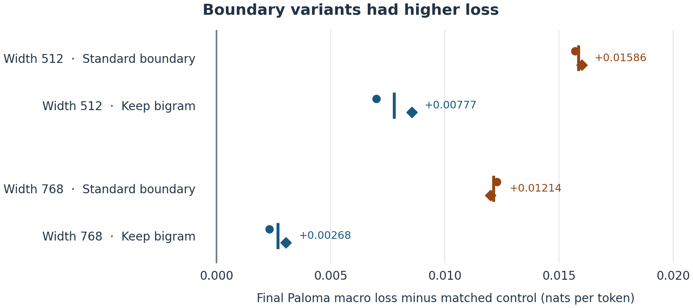

We added a boundary operator to Marin's Grug mixture-of-experts recipe to see whether a result from dense Transformers would carry over at a fixed token budget. At the same training token budget, the standard operator raised final Paloma loss by 0.01586 at hidden width 512 and 0.01214 at width 768, averaged over two seed pairs at each width. A variant that kept a token-bigram feature separately available to later layers recovered part of the increase. Both variants had higher loss than their matched controls in every pair. [Final paired measurements](https://github.com/marin-community/marin/issues/9280#issuecomment-5901009948)

[Marin experiment #9280](https://github.com/marin-community/marin/issues/9280)

## Background

Chen and colleagues reported that a dense Transformer with their boundary operator could match the validation loss of a standard Transformer trained with 1.25 times as much compute at the paper's 10²⁰ FLOP comparison. Their operator splits the layers into a prelude, a core, and a coda. At each boundary, the next group starts from a summary of earlier representations. We tested the operator by itself in Grug before trying the paper's growth and looping methods. [Paper, section 4.2](https://arxiv.org/html/2609.19107v2#S4.SS2)

## Approach

In the Grug control, layers can select from earlier representations, including a gated feature derived from adjacent token pairs. The standard operator replaces the earlier sources with one summary at each boundary. The core starts from the prelude output. The coda starts from the RMS-normalized core output plus the prelude output. We tested whether the loss penalty would shrink if layers could still access the bigram feature separately. This variant splits each boundary summary into the gated bigram feature and the rest, so layers can select either source. The variant keeps the same parameter shapes. [Standard implementation](https://github.com/marin-community/marin/commit/fdad71be182f8ddf695e8c7286b6471e209981cc) · [Bigram variant](https://github.com/marin-community/marin/commit/197131f8c79e8d016e01302e13b3b32f46da4307)

Within each width, control and treatment shared the training data, optimizer recipe, attention windows, and number of updates. We ran 2,817 updates at width 512 and 7,325 at width 768 on eight H100s per run. For the primary result we evaluated the exponential moving average of the model weights on Paloma, giving each held-out text dataset in the suite equal weight. [Run configuration and evaluation](https://github.com/marin-community/marin/issues/9280#issuecomment-5901009948)

## Results

Keeping the bigram feature separate reduced the mean loss increase to 0.00777 at width 512 and 0.00268 at width 768. Both seeds still had higher loss than their controls at each width. The standard and bigram-preserving arms also trailed their controls at the recorded width-768 midpoint. [Width 512](https://github.com/marin-community/marin/issues/9280#issuecomment-5899525010) · [Width 768](https://github.com/marin-community/marin/issues/9280#issuecomment-5900468443)

*Each point subtracts the final Paloma macro loss of a same-width, same-seed control. Circles and diamonds mark the two seeds. The vertical ticks show their means. Zero indicates equal loss. [Source table](https://github.com/marin-community/marin/issues/9280#issuecomment-5901009948)*

We paused this line after the matched sweep. The result applies to the tested Grug recipe and fixed training budgets. We used the inherited optimizer settings and tested two widths, so the result leaves open what operator-specific tuning would recover and how the operator changes the rate at which loss falls with more training compute. [Experiment closeout](https://github.com/marin-community/marin/issues/9280#issuecomment-5901009948)
