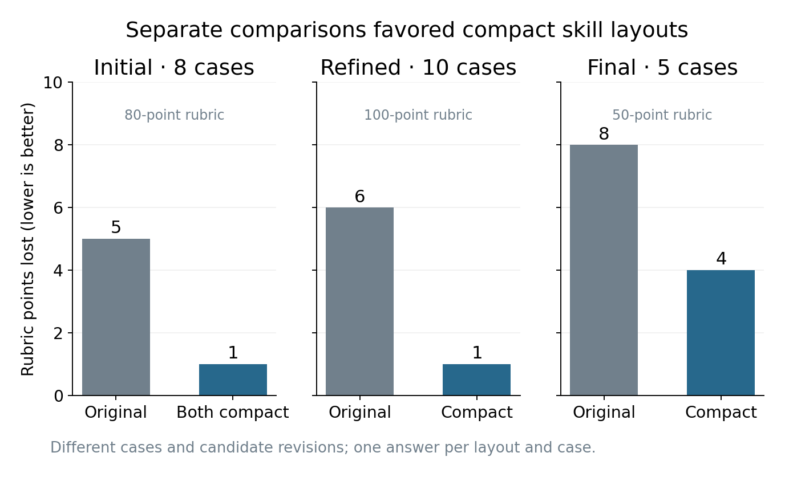

We replaced several narrow operational skills with entry points that load short references when needed. They cover Iris, our job orchestrator, and Finelog, its log and telemetry store. In three blinded comparisons, the compact layouts scored higher on the fixed operational-answer rubrics. The final comparison scored 46 out of 50 against 42 out of 50 for the original layout. The agent selected the task-specific references needed by the evaluated cases. Each layout produced one answer per case, so the results guided a local documentation change with limited statistical evidence. [Evaluation record](https://github.com/marin-community/marin/issues/8634)

[Marin experiment #8634](https://github.com/marin-community/marin/issues/8634) · [Merged change #8636](https://github.com/marin-community/marin/pull/8636)

## Approach

A skill gives an agent instructions for a task. With many narrow skills, selecting the right one becomes part of the task. Our operational questions often crossed the old boundaries between job inspection, federation, monitoring, and log analysis.

The final consolidation replaced five top-level Iris workflow skills with conditional references. The revised layout gave ordinary Iris work one entry point and telemetry queries another. The Iris entry point pointed to compact references for monitoring jobs, rolling out controllers, allocating development accelerators, and recovering stuck pods. For example, a monitoring request could load the monitoring reference, while an ordinary job-status question could use the entry point alone. Separate workflows remained for work crossing those domains. [Merged skill layout](https://github.com/marin-community/marin/pull/8636)

Fresh Luna sessions answered identical questions in read-only planning mode. A separate session graded anonymized answers against correctness, provenance, safety, and completion criteria. The first comparison used eight cases; a fresh ten-case comparison added two held-out questions. A final five-case comparison tested the broader consolidation. [Pinned prompts and experiment record](https://github.com/marin-community/marin/blob/bf5f867293aa77f3e21f2be4a47beb0e248dd0bf/.agents/logbooks/iris-skill-generalization.md)

## Results

*Each pair is one evaluation with its own case set and maximum score. In the first panel, both compact candidates tied at the plotted score. The candidate changed between comparisons. Scores are human-defined rubric points assigned by another model, not independent repeated measurements. [Source results](https://github.com/marin-community/marin/issues/8634#decision-log)*

The initial generic and layered candidates both scored 79 out of 80 versus 75 for the original. The refined candidate scored 99 out of 100 versus 94, including full marks on the two held-out cases. In the final comparison, its actionable miss was describing a rollout approval without giving the exact command. Adding that command to the short reference made it discoverable in a focused follow-up. [Evaluation and follow-up](https://github.com/marin-community/marin/blob/bf5f867293aa77f3e21f2be4a47beb0e248dd0bf/.agents/logbooks/iris-skill-generalization.md)

The final comparison had no safety deduction, but it exercised answers rather than live operations. Different cases, model samples, or graders could change the margins. We adopted the consolidation because the observed answers retained the required references and improved source selection on the tested work.
