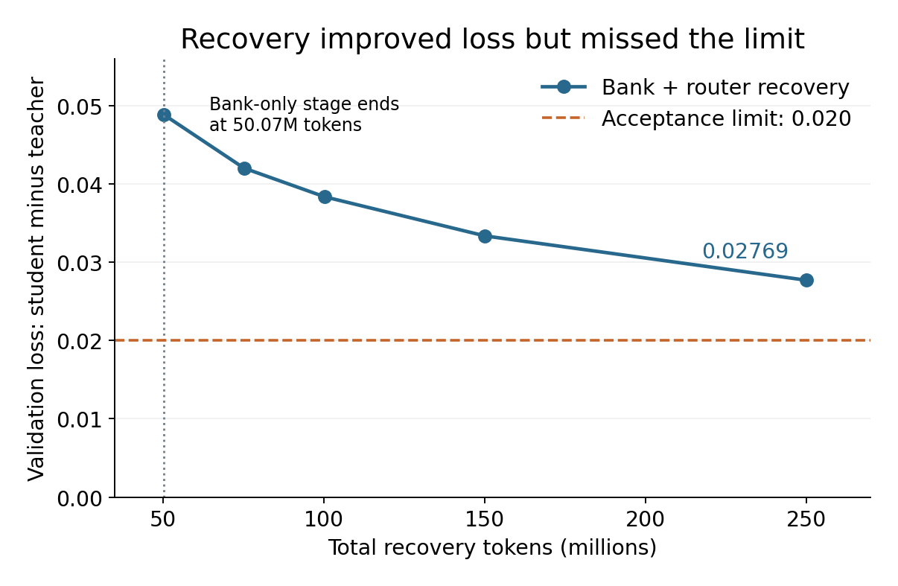

We tried to compress a trained Grug mixture-of-experts checkpoint by replacing two adjacent layers' expert banks with one shared bank. After 250 million recovery tokens, the selected student remained 0.02769 validation loss above its untied teacher. The acceptance limit was 0.020. Its separate Paloma gap was equivalent to about 0.20 baseline compute doublings. The tested recovery recipe missed its target. [Recovery measurements](https://github.com/marin-community/marin/issues/8032#issuecomment-5224948511)

[Marin experiment #8032](https://github.com/marin-community/marin/issues/8032)

## Approach

Training a model with shared weights from initialization lets its layers adapt together. Converting an existing model starts from expert banks that have already learned different functions. Our conversion took a width-512, six-layer Grug checkpoint and made layers 2 and 3 share layer 2's bank. Their routers and other layer weights remained separate.

We first matched expert slots between the two banks, so the layer-3 router could select corresponding experts in the retained bank. We then trained the shared bank to recover the original model's behavior. The selected first stage held the routers fixed for 50.07 million tokens. It combined local expert-output matching with language-model cross-entropy and teacher-logit matching. The second stage trained the shared bank and affected routers for a further 200.02 million tokens while continuing to match the teacher. The CE-plus-KL first stage was selected from four objectives by its held-out Paloma result. [Conversion definitions and objectives](https://github.com/marin-community/marin/issues/8032#terms-used-in-this-issue)

The local target used the teacher's expert output on the student's current layer input. That lets recovery see the states the converted network actually produces. Attention, the other expert banks, and the output head stayed frozen. The student therefore had a limited set of weights with which to repair the change.

We measured next-token cross-entropy on the standard Grug validation collection, which includes Paloma and Uncheatable datasets. The validation metric averages over tokens across the collection; Paloma macro loss gives equal weight to each dataset in its Paloma subset. Both compare the same student and teacher, with separate acceptance limits. [Evaluation definitions](https://github.com/marin-community/marin/blob/34cad234df/experiments/grug/moe/merge_recovery_runtime.py)

## Results

*Total tokens include both recovery stages. The plotted quantity subtracts the teacher's validation loss. Points begin at the end of the 50.07-million-token bank-only stage and continue through bank-and-router recovery. The 0.020 line is the original 100-million-token criterion, retained as a reference during the extension. [Exact token counts and measurements](https://github.com/marin-community/marin/issues/8032#issuecomment-5224948511)*

At the original 100-million-token decision point, validation and Paloma gaps were 0.03835 and 0.03535. Both exceeded their respective limits of 0.020 and 0.030. Continuing to 250 million tokens reduced the Paloma gap to 0.02583, while validation still missed its limit. The two evaluation summaries therefore gave different acceptance outcomes.

The remaining Paloma gap is about one fifth of a baseline compute doubling. The teacher's Paloma loss was approximately 3.595. Re-anchoring the baseline law `L(C) = 1.6 + A * C^(-0.0941)` at that loss gives about 0.126 nats per token of improvement for a doubling of pretraining compute. The 0.02583-nat residual gap corresponds to 0.20 doublings, or a 1.15× compute-equivalent penalty. The multiplier is `((L_student - 1.6) / (L_teacher - 1.6))^(1/0.0941)`. [Scaling fit, #6074](https://github.com/marin-community/marin/issues/6074) · [Teacher and student evaluation record](https://github.com/marin-community/marin/blob/34cad234df/.agents/logbooks/grug-cross-layer-expert-merging.md)

This is a quality comparison with the baseline model family's pretraining curve. The fit uses Paloma macro loss, so we apply it to the Paloma gap; the token-averaged validation gap remains the separate acceptance criterion. The estimate does not include conversion cost or predict that 15% more recovery tokens would repair the student, whose trainable weights are restricted.

Other initialization and recovery approaches also left gaps. Improving the expert-assignment objective did not establish better immediate model loss, and fitting cached expert outputs did not reliably improve subsequent model recovery. We stopped the tested conversion series. The result concerns one pair of banks in the width-512 checkpoint, with the recorded frozen weights, objectives, and token budgets. [Comparison of conversion approaches](https://github.com/marin-community/marin/issues/8032#completed-d512-one-pair-surgery)
