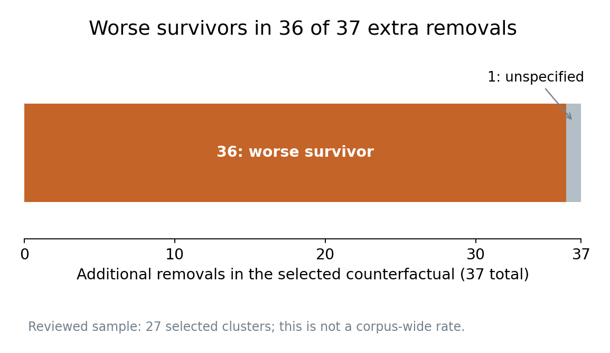

A deduplication change can remove more redundant text while keeping worse copies. In a reviewed counterfactual over 27 selected clusters, strict re-clustering added 37 removals. Reviewers judged the surviving document worse in 36 of those cases. All changed pairs preserved the removed text under the audit's normalized-containment check. We rejected the stricter re-clustering change pending an explicit policy for which source should survive. [Counterfactual and full-text review](https://github.com/marin-community/marin/issues/8155#issuecomment-5267128192)

[Marin experiment #8155](https://github.com/marin-community/marin/issues/8155)

## Approach

Fuzzy deduplication first groups likely near-copies using shared MinHash buckets, which are hash-based similarity candidates. The stored graph could connect documents sharing one bucket. The strict counterfactual required two shared buckets before rebuilding the groups, then applied the unchanged verifier. This altered which documents were compared and which became survivors. [Re-clustering definition](https://github.com/marin-community/marin/issues/8155#issuecomment-5266952954) The retained document is the survivor. Information containment asks whether the survivor still contains the removed text. Survivor quality asks whether that copy is preferable to the one being deleted.

Those questions differ when a longer document contains an original text plus generated material. Containment may justify calling the original redundant. Retaining the longer derivative also changes which source and surrounding text appear in training. The public review describes base documents replaced by longer generated derivatives, including added question-and-answer text in a related inspection. It does not publish a complete scoring rubric. We therefore report “worse” as the reviewers' preference judgment; synthetic provenance alone does not establish a quality loss. [Related full-text inspection](https://github.com/marin-community/marin/issues/8155#issuecomment-5264093148) [Audit record](https://github.com/marin-community/marin/issues/8155#issuecomment-5267128192)

We compared the stored verifier with a stricter re-clustering counterfactual on 1,240 documents from the same 27 selected clusters. The stored verifier made 22 removals using 2,191 comparisons. Re-clustering made 57 removals using 1,594 comparisons. It added 37 removals and lost two that the stored verifier made.

## Results

*Labels describe the extra removals in this selected counterfactual. They are review judgments about the retained copy. [Public aggregate record](https://github.com/marin-community/marin/issues/8155#issuecomment-5267128192)*

Thirty-three new removals moved from a base source into a generated or synthetic derivative. Those cases accounted for 96.3% of the newly removed whitespace-token count. The two removals lost by the stricter rule had also kept worse survivors under the original verifier, so retaining those documents was preferable in the audit.

The result argued against using removal count alone to choose this change. The immediate decision was to keep the existing comparison cap of two and defer strict re-clustering until a source-survivor policy and broader cluster coverage were available. The completed audit later recommended a separate policy with an exact token-sequence and line-count local guard, two comparisons, and 32 representatives. That policy still left reviewed worse-survivor cases. [Final audit decision](https://github.com/marin-community/marin/issues/8155#issuecomment-5271807827) [Recorded decision](https://github.com/marin-community/marin/issues/8155#issuecomment-5267128192)

These selected clusters do not estimate the rate across the training corpus. The detailed labels and full-text review queue are private. The public issue supplies the aggregate counts used here, so readers can inspect the conclusion and its scope but cannot independently repeat the judgments from public artifacts alone.
