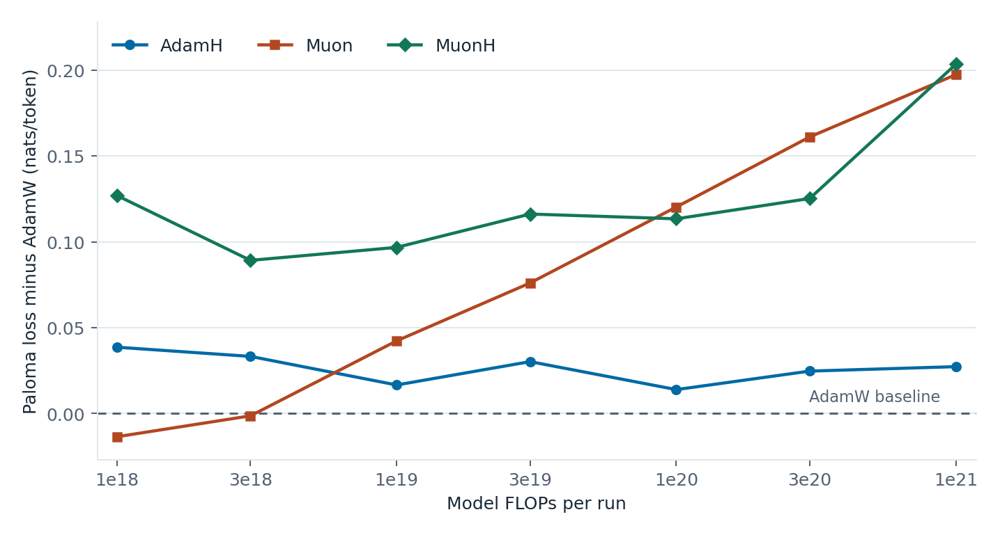

Muon had the lowest final validation loss at the two smallest budgets in our dense optimizer ladder. AdamW led at the next five budgets, from 1e19 to 1e21 model FLOPs. At 1e21 FLOPs, its loss was about 0.20 nats per token lower than either Muon recipe. We calibrated learning rates at the smallest budget and transferred them to the larger ones, so the result compares those specific training recipes.

[Logbook #15](https://github.com/marin-community/marin-logbooks/issues/15) · [Final measurements and run IDs](https://github.com/marin-community/marin-logbooks/blob/0d4c8b86412f52d6dad016b1a69f701585b21bb0/logbooks/15-hero-dense-optimizers/final-results-20261103.json)

## Background

Delphi used AdamH for its dense scaling law. At each compute budget, it swept the tradeoff between model size and training tokens to find the allocation with the lowest loss. It then used those losses to forecast larger runs. Here we ask how optimizer recipes rank on the Hero mixture when they share one model shape and token budget at each scale. [Delphi scaling study](https://marin.community/blog/2026/05/11/delphi/)

## Approach

We trained dense models on the phased Hero pretraining mixture from the original Harrier dataset store to see how four optimizers compared as the budget grew. Within each rung, all four recipes used the same model shape, data order, seed, and number of training tokens. Model size and token count increased together across rungs. Each run used a single eight-H100 node and 4,096-token sequences. The largest rung used a 2.81B-parameter model and 59.36B tokens. The budget counts forward and backward model FLOPs, including attention and the language-model head. Optimizer work is outside that budget. [Design and run configurations](https://github.com/marin-community/marin-logbooks/blob/0d4c8b86412f52d6dad016b1a69f701585b21bb0/logbooks/15-hero-dense-optimizers/notebook.md#2026-10-26-initial-design-and-launch-contract)

We compared AdamW, Muon, AdamH, and MuonH. AdamW and Muon used decoupled weight decay. AdamH and MuonH kept the Frobenius norm of each updated weight matrix fixed and used AdamH on the output head. Muon used AdamW on the head.

At 1e18 FLOPs, we tried three learning-rate multipliers for each recipe and chose the run with the lowest final loss on [Paloma](https://arxiv.org/abs/2312.10523), a language-modeling benchmark spanning English and code. Those runs supply the 1e18 results below. AdamW, AdamH, and Muon all selected the largest multiplier in the grid. For larger budgets, we multiplied each selected learning rate by `(calibration tokens / target tokens)^0.3`, the same token-horizon factor Delphi used for projection weights. Delphi also scaled its projection learning rate with batch size. We held batch size fixed. [Optimizer recipes](https://github.com/marin-community/marin-logbooks/blob/5e46cfb93934c8c5e9a218f45117685887410d59/experiments/grug/fast_track/dense_optimizers.py)

## Results

We report the unweighted mean of the per-dataset next-token losses on Paloma. Muon’s advantage over AdamW was 0.0135 nats per token at 1e18 FLOPs and 0.0013 at 3e18. From 1e19 onward, AdamW had the lowest loss at every rung. At 1e21, final losses were 2.834 for AdamW, 2.861 for AdamH, 3.031 for Muon, and 3.037 for MuonH. [Final loss table](https://github.com/marin-community/marin-logbooks/issues/15#final-results)

*Each point subtracts the final loss of the matched AdamW run at that budget. The four recipes at a given budget shared the same shape, data, token count, and seed.*

We used one seed, so the run-to-run variation in gaps as small as 0.0013 nats per token remains unknown. AdamW’s lead applies to the tested recipes on the Hero mixture. Ranking the optimizers on Delphi would require comparing them on its data, model shapes, and training allocations.
