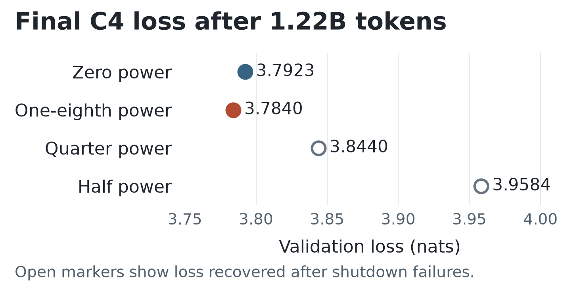

We tested whether tuned quarter-power [EMA-Gram preconditioning][protocol] could improve C4 English validation loss over zero and half power in a 447M-parameter experiment with one seed. At 1.22B tokens, quarter power's [recovered loss][endpoints] was higher than the [zero-power Muon-style baseline's][zero-run] and lower than half power's recovered loss. [One-eighth power][one-eighth-run] joined the comparison after it beat one-third power in the pilots. It reached the [predeclared target of 4.0 nats or lower][target] with 2.9% fewer training tokens than zero power. It took 7.47× as much elapsed time to get there. Zero power ran on four TPU v4 devices and one-eighth on 16, with different parallelism layouts and [launch revisions][revisions].

[Marin issue #10784](https://github.com/marin-community/marin/issues/10784) · [Marin logbook issue #20](https://github.com/marin-community/marin-logbooks/issues/20)

## Background

[Muon][muon] turns a momentum matrix into an update direction by approximately flattening its singular values. The exact operation, called the polar factor, gives each nonzero singular direction unit gain. An [earlier one-sided preconditioning experiment][prior] reported lower validation loss when it capped the amplification of directions with small recent gradients. We wanted to see how strongly to reweight directions when using gradient history on both sides of the update.

In EMA-Gram, we keep two exponential moving averages of gradient products, one for rows and one for columns. These Gram matrices track which directions have had large gradients recently. We normalize each Gram matrix and add a small diagonal offset called a ridge. We then take a negative power of the resulting matrix, which gives less weight to directions with larger eigenvalues. The ridge sets a floor on the eigenvalues to limit how much the negative power amplifies directions with small recent gradients. We apply the resulting weights on either side of the momentum matrix before the polar operation, then again on either side of its output. At zero power both weights are identity matrices. The baseline still updates the Gram averages and applies the polar approximation directly to momentum.

## Approach

We used final C4 loss from [37 pilots of about 250M tokens each][pilots] to select matrix learning rates and, for nonzero powers, ridges. We set the 4.0 loss target before any long-run results. Each long run started from scratch with seed 0 and used the [447M Delphi architecture][delphi] and the same [fixed subset of web, code and math data][execution]. The subset replaced unavailable original Delphi web data.

## Results

At the scheduled final evaluation after 37,335 updates (1.22B tokens), one-eighth power reached 3.7840 nats, 0.0083 below zero power's 3.7923. Both quarter and half power reached that evaluation and failed during shutdown. We recovered their final losses of 3.8440 and 3.9584 nats from local logs.

*Final C4 English validation loss at the scheduled evaluation after 37,335 updates, with one seed per setting. Open markers show values recovered from local logs after shutdown failures. [Source data][data].*

We evaluated C4 loss every 1,000 updates and once at the end. The first recorded evaluation at or below 4.0 was at 33,000 updates (1.081B tokens) for one-eighth power and 34,000 updates (1.114B tokens) for zero power. Those runs took 35.63 and 4.77 elapsed hours, respectively, or about 570 and 19 TPU device-hours. Quarter and half power also have [recorded threshold crossings and runtimes][target]. The chart focuses on the two runs that completed successfully.

*First recorded evaluation at or below 4.0 nats for the two completed runs. Elapsed time includes compilation and evaluation and excludes queueing. Device-hours multiply elapsed time by the TPU device count. [Source data][data].*

Both completed runs used four model replicas. Each replica ran on one device at zero power and was split across four at one-eighth power. Measuring the optimizer's share of the time difference would require a matched setup. How much the loss and token differences vary across seeds remains open.

[one-eighth-run]: https://wandb.ai/marin-community/marin/runs/ema-gram-confirmation-3e18-a0.125-seed0-62811d347d39-2026.11.06.02-2d6d43d719e9
[zero-run]: https://wandb.ai/marin-community/marin/runs/ema-gram-confirmation-3e18-a0-seed0-994a222dc7b9-2026.11.05.14-0c1aa5489b5c
[target]: https://github.com/marin-community/marin-logbooks/blob/48d81f8cd358b7194a6620cf6b54ccb40541669c/logbooks/20-ema-gram-polar/single-seed-findings.md#observed-time-and-device-cost
[muon]: https://kellerjordan.github.io/posts/muon/
[prior]: https://github.com/marin-community/marin/pull/6588#issuecomment-4794166033
[protocol]: https://github.com/marin-community/marin-logbooks/blob/48d81f8cd358b7194a6620cf6b54ccb40541669c/experiments/ema_gram/README.md#update-and-fixed-controls
[pilots]: https://github.com/marin-community/marin-logbooks/blob/48d81f8cd358b7194a6620cf6b54ccb40541669c/logbooks/20-ema-gram-polar/subset-final-selection-lock.json
[delphi]: https://marin.community/blog/2026/05/11/delphi/
[execution]: https://github.com/marin-community/marin-logbooks/blob/48d81f8cd358b7194a6620cf6b54ccb40541669c/logbooks/20-ema-gram-polar/single-seed-execution-plan.md#fixed-subset-execution-amendment-2026-11-04-2335-utc
[endpoints]: https://github.com/marin-community/marin-logbooks/blob/48d81f8cd358b7194a6620cf6b54ccb40541669c/logbooks/20-ema-gram-polar/single-seed-findings.md#setup-and-comparison-scope
[data]: https://github.com/marin-community/marin-logbooks/blob/48d81f8cd358b7194a6620cf6b54ccb40541669c/logbooks/20-ema-gram-polar/single-seed-comparison.json
[revisions]: https://github.com/marin-community/marin-logbooks/compare/f99298782188e8f1c4e1ad8a1b2a507693d653e8...923d79510475df3ed0fef53d40b3290ae4c90fce
