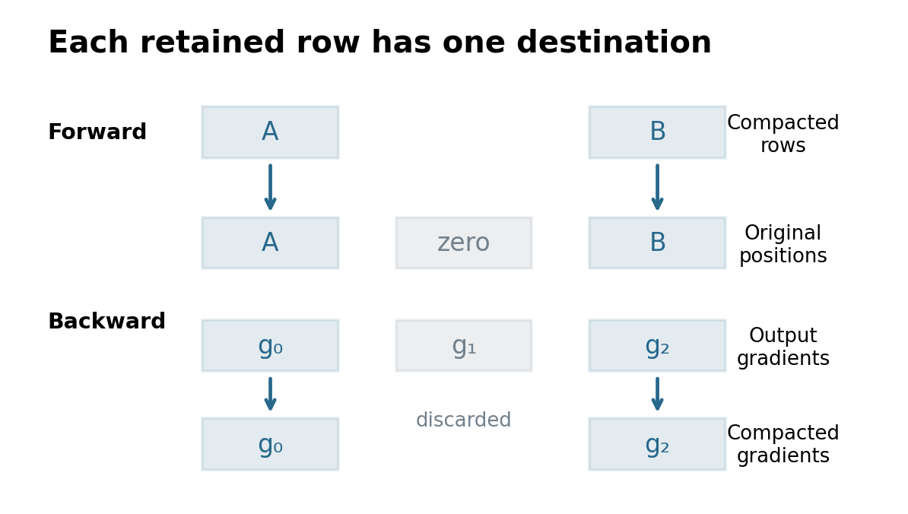
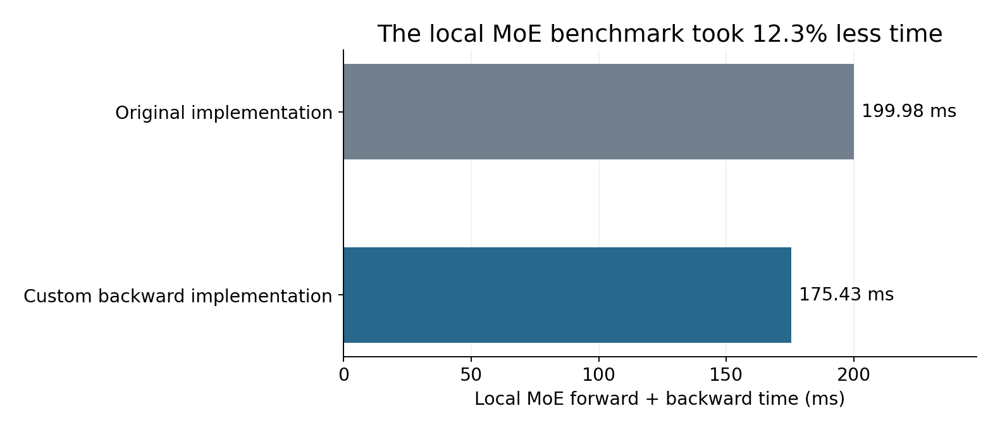

An expert-routing gather in Grug had a more expensive backward pass than its index map required. Each retained row appeared once, but automatic differentiation used a general scatter-add with atomic updates. A custom backward used that uniqueness to gather gradients instead. At the measured revision, the local MoE forward-plus-backward benchmark fell from 199.98 to 175.43 milliseconds. [Implementation](https://github.com/marin-community/marin/commit/1912d25067db1eb55d10662070eb956a273e04f1) · [Benchmark, MEP-083](https://github.com/marin-community/marin/blob/0fb10e56ba22c88681158e81ea0deb2e0c3bc8cb/.agents/logbooks/marin-ep.md)

[Marin experiment #8311](https://github.com/marin-community/marin/issues/8311)

## Approach

An expert-parallel MoE sends tokens to the GPUs holding their chosen experts, then restores the outputs to the original assignment positions. Capacity filtering can remove assignments, so the implementation keeps a compacted buffer plus a mask that says which original positions survived.

Suppose the mask is `keep, drop, keep`. Expanding compacted rows `A, B` produces `A, zero, B`. In backward, the gradient at original position 0 goes to A, the gradient at position 2 goes to B, and the dropped position contributes nothing.

*Illustration of the retained-row map. Dropped positions produce zeros.*

A general gather can read the same row several times. Its backward must add all the corresponding gradients, often using atomic scatter-adds. This map is injective on retained compacted assignment rows, meaning each appears at most once. A token can still have assignments to several experts; uniqueness applies to these buffer rows. We supplied a custom backward that constructs the reverse map and reads each gradient directly. [Measured source change](https://github.com/marin-community/marin/commit/1912d25067db1eb55d10662070eb956a273e04f1)

## Benchmark

The local benchmark ran on one GB200 tray with the production model's per-device expert workload. It timed the fused MoE forward and backward together. The comparison therefore includes the routing and expert computation around the changed operation. [Benchmark record](https://github.com/marin-community/marin/blob/0fb10e56ba22c88681158e81ea0deb2e0c3bc8cb/.agents/logbooks/marin-ep.md)

*Forward-plus-backward time for the same local benchmark case. The improvement is about 12.3%. [MEP-083 measurements](https://github.com/marin-community/marin/blob/0fb10e56ba22c88681158e81ea0deb2e0c3bc8cb/.agents/logbooks/marin-ep.md)*

The full-rack comparisons did not isolate the change's effect. In same-night comparisons, the fused backend's gap to the incumbent narrowed from 1.21 seconds per step before the change to about 0.34 afterward, using two treatment draws in the latter comparison. The measurements were on different nights, and the control itself moved by 2.8% between nights. The remaining gap was comparable to the observed placement variation, so throughput parity stayed unresolved. [Rack measurements, MEP-084](https://github.com/marin-community/marin/blob/0fb10e56ba22c88681158e81ea0deb2e0c3bc8cb/.agents/logbooks/marin-ep.md)
