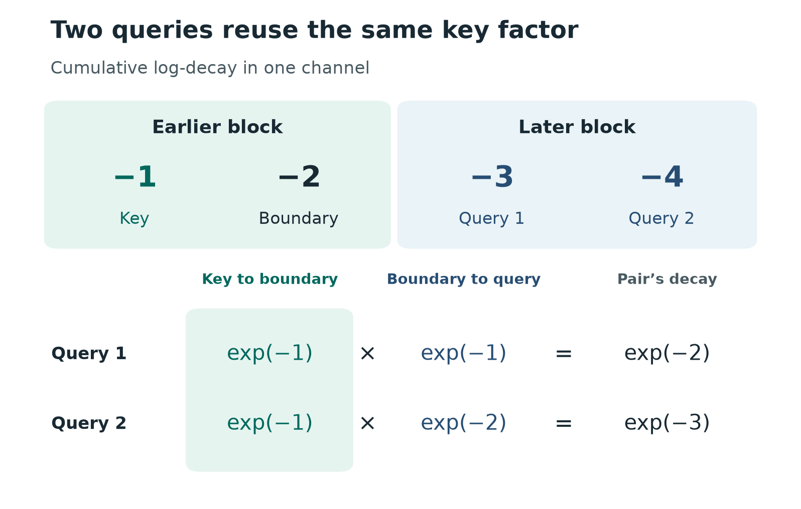
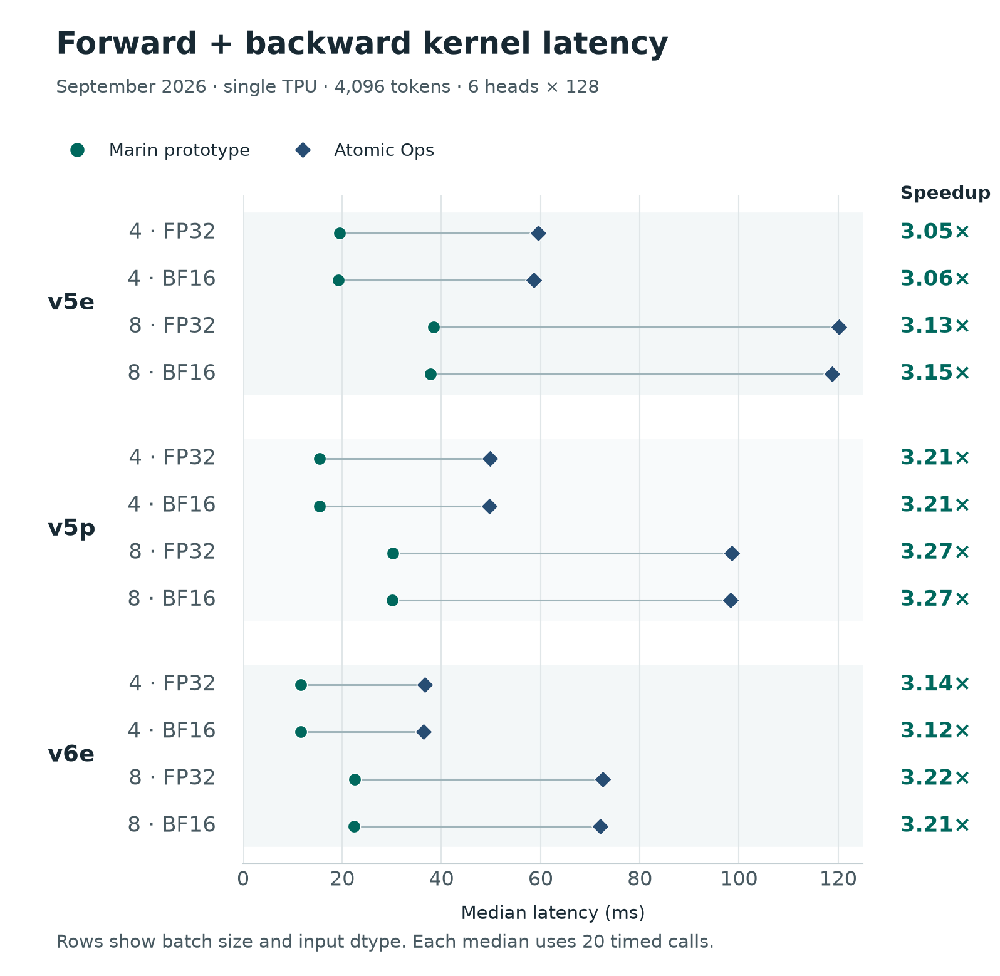

Our September 2026 Gated DeltaNet-2 prototype took about one-third of the forward-and-backward time of the Atomic Ops kernel on a single TPU v5e, v5p, or v6e at batches of 4 and 8. The prototype uses the TPU’s matrix units for part of the decay calculation. The timing covers the full kernel and includes several other changes. [Atomic Ops baseline at `a9bd7c5`](https://github.com/Akseleu-J/atomic-ops/tree/a9bd7c5315907d23ccf1ce6b033d46a196566888) · [Archived measurements](https://github.com/marin-community/marin-logbooks/blob/bc377bb875485b5170d8eb222b2ee5d228fb0933/logbooks/42-gdn2-tpu/measurements/README.md)

[Marin #9350](https://github.com/marin-community/marin/pull/9350) · [Logbook issue #42](https://github.com/marin-community/marin-logbooks/issues/42)

## Background

Gated DeltaNet-2 is a linear attention layer. It keeps a fixed-size matrix as state and uses a separate decay rate for each channel. A training kernel processes tokens in chunks so it can compute many interactions at once. Within a chunk, each later token’s query is scored against earlier tokens’ keys to help determine how much their updates contribute to its output. [Gated DeltaNet-2 paper](https://arxiv.org/abs/2605.22791)

For each channel, the cumulative log-decay is the sum of that channel’s log-decays through the current token. Subtract an earlier token’s cumulative value from a later token’s and exponentiate the difference to get the decay factor between them. Atomic Ops computes this factor for every token pair and channel, multiplies it into the query and key components, and sums over channels.

## Approach

Split a chunk into two consecutive blocks. For a pair that spans the blocks, split the decay at the last token of the earlier block. In one channel, take a key at cumulative log-decay −1, a boundary token at −2, and two queries at −3 and −4. The factor from the key to the boundary is exp(−1). The query at −3 multiplies it by exp(−1) to get exp(−2). The query at −4 reuses the same key factor and multiplies it by exp(−2) to get exp(−3). [Score kernel](https://github.com/marin-community/marin/blob/3ddce3402ea81c3c4462864975fdf17851995acb/lib/levanter/src/levanter/kernels/pallas/gdn2/candidate/gdn2_fwd.py#L93-L126)

*Both queries reuse the decay factor from the key to the boundary.*

The kernel scales each query and key vector channel by channel with these token factors. The dot product of the two scaled vectors includes the correct decay in every channel. Stacking the scaled vectors as rows in query and key matrices lets the TPU compute the scores between the blocks in one matrix multiply, `Q @ K.T`. For a forward score tile with 64 queries and 64 keys, the kernel computes 128 token factors per channel in place of 4,096 pairwise factors. Within a block, there is no shared split point between every valid key and query, so the kernel keeps the pairwise calculation there.

## Single-device benchmark

We tested batches of 4 and 8 with 4,096 tokens per sequence, six heads of width 128, and FP32 or BF16 inputs. We checked both kernels against an independent CPU implementation that processes one token at a time before accepting timings. [Benchmark method](https://github.com/marin-community/marin-logbooks/blob/bc377bb875485b5170d8eb222b2ee5d228fb0933/logbooks/42-gdn2-tpu/benchmark.md#correctness-and-timing)

The archived prototypes were 3.05–3.27× as fast as Atomic Ops for the combined forward and backward pass. On v6e at batch 8 in BF16, both kernels used the same tile sizes, and median time fell from 72.03 ms to 22.44 ms. The prototype also changes the within-block score calculation and the solve. The latency gain from the decay factorization alone remains unmeasured. [Source snapshots and timing samples](https://github.com/marin-community/marin-logbooks/blob/bc377bb875485b5170d8eb222b2ee5d228fb0933/logbooks/42-gdn2-tpu/measurements/README.md)

*Each point is the median of 20 synchronized calls using that implementation’s fastest tested tile for the workload.*

The refactored kernel in Levanter retains the decay factorization. Its latency at these shapes and its effect on full-model training throughput remain open. [Pinned notebook](https://github.com/marin-community/marin-logbooks/blob/bc377bb875485b5170d8eb222b2ee5d228fb0933/logbooks/42-gdn2-tpu/notebook.md)
