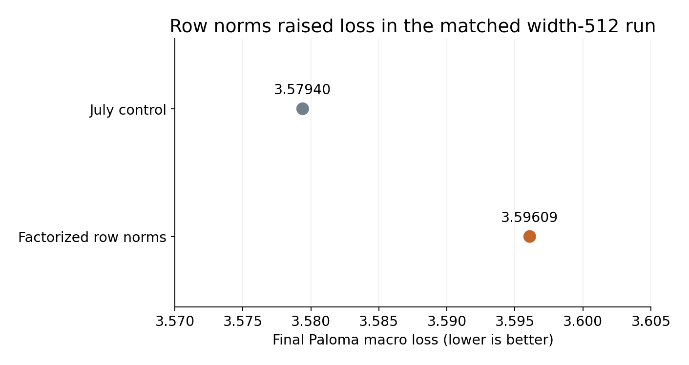

Separating each linear projection's output scale from its matrix direction worsened the tested Grug mixture-of-experts recipe. In the matched width-512 comparison, final Paloma loss rose from 3.57940 to 3.59609 and throughput fell 1.98%. We stopped before testing the next model width. [Final paired result](https://github.com/marin-community/marin/issues/8131#issuecomment-5248715081)

[Marin experiment #8131](https://github.com/marin-community/marin/issues/8131)

## Approach

A linear projection computes `W x`. The treatment wrote this as `v * (W x)`, where `v` contains one learned scale for each output coordinate. Initializing every scale to one and copying the original matrices preserves the network's initial function.

The factorization covered attention projections and gates, expert and dense feed-forward projections, GatedNorm projections, routers, and the output head. Token embeddings stayed unchanged. After each update, the optimizer rescaled every MuonH matrix row back to its pre-update L2 norm. It likewise rescaled each output-scale vector to its pre-update norm, separately for each expert where applicable. The intended benefit was to let the optimizer change output scale separately from matrix direction. This changes how the model moves through parameter space even though it starts with the same predictions.

For matrices normally trained with MuonH, the treatment applied its norm preservation per output row. The scale vectors used AdamH, an Adam-direction update followed by norm restoration. The language-model head kept its AdamH matrix update, while router and attention-gate matrices kept their existing optimizer path. [Measured implementation and recipe](https://github.com/marin-community/marin/blob/ddfdee98467aca31ffbd312b34420b24e4b759a8/.agents/logbooks/moe-row-norm-july.md)

## Results

The control and treatment descended from the same July recipe and matched on architecture, training data, schedule, optimizer scalars, and TPU allocation. Both used hidden width 512, sequences of 8,192 tokens, batches of 16, and 10,980 updates on a v5p-8. Paloma macro loss averages the losses of the held-out text datasets equally. [Matched runtime record](https://github.com/marin-community/marin/issues/8131#issuecomment-5248252832)

*One completed width-512 run per arm at the same update budget; the loss increase is 0.01669. Lower loss is better. [Final result](https://github.com/marin-community/marin/issues/8131#issuecomment-5248715081)*

Mean throughput over the final 100 steps was 355,680 tokens per second for the control and 348,644 for the treatment. The experiment's scaling-law calculation, combining the loss and speed differences, estimated effective speed at 0.8965 times the control. The estimate uses `loss(C) = 1.6 + A * C^(-0.0941)`, fitting A to the same-width control. It divides the estimated baseline time to match the treatment's loss by the treatment's observed training time. That assumes the baseline scaling curve and measured throughput continue to apply. It therefore failed the first screening scale.

The result identifies a negative case for this factorization, constraint, and optimizer combination. Each arm ran once. The experiment did not establish which part of the changed optimization geometry caused the loss increase, and it did not measure the treatment at larger widths. [Pinned terminal record](https://github.com/marin-community/marin/blob/ddfdee98467aca31ffbd312b34420b24e4b759a8/.agents/logbooks/moe-row-norm-july.md)
