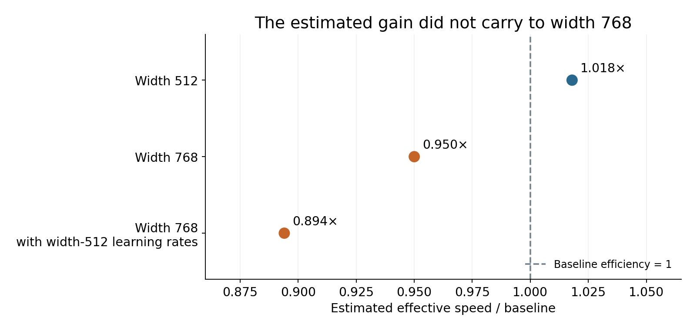

We tested learned weights on Grug's residual merges to see whether they improved training efficiency at two small model widths. The experiment's effective-speed estimate reached 1.018 times the July baseline at width 512 and 0.950 at width 768. Using the smaller model's learning-rate pair at width 768 reduced that estimate to 0.894. The recipe failed its two-width screen, and we stopped the series. [Final results](https://github.com/marin-community/marin/issues/8860#issuecomment-5576159372)

[Marin experiment #8860](https://github.com/marin-community/marin/issues/8860)

## Approach

A residual merge combines the running representation with an attention or feed-forward update. The baseline simply adds them: `residual + update`. We replaced each such merge in layer l with `sqrt(1 - beta_l/L) * residual + sqrt(beta_l/L) * update`, where L is the number of layers. The two coefficient squares sum to one. Their unit squared sum does not guarantee preservation of the output norm, which also depends on the norms and alignment of the two vectors.

One learned scalar per layer supplied beta for both the attention and MoE merges. We set `beta_l = softplus(theta_l)` with theta initially zero, giving beta about 0.693. Beta was capped below L so both square roots remained defined. At initialization, the residual/update coefficients were 0.9405/0.3399 at width 512 and 0.9557/0.2944 at width 768. The comparison used the canonical July Grug recipe as its baseline. [Measured formulation](https://github.com/marin-community/marin/blob/96b2fcb4eae6d5ff22668e2d2fcee0b3ebdb7c12/.agents/logbooks/norm-preserving-residual.md)

## Results

Each treatment matched its same-width July baseline's data, optimizer recipe, evaluation, and update budget on a v5p-8 TPU. Width 512 used six layers and 10,980 updates; width 768 used eight layers and 16,875 updates. Baselines were historical runs, with one seed per reported cell.

At width 512, treatment Paloma loss was 3.55702 versus the baseline's 3.56670, while throughput fell from 352,609 to 340,730 tokens per second. At width 768, loss was 3.22823 versus 3.22720, and throughput fell from 249,954 to 239,031. Paloma macro loss gives each held-out text dataset equal weight. [Quality and timing table](https://github.com/marin-community/marin/issues/8860#results)

*The estimates combine the loss change through the baseline scaling law with observed throughput. A run to a common loss was not timed directly. Each treatment cell used one seed. [Source results](https://github.com/marin-community/marin/issues/8860#results)*

The estimate uses `loss(C) = 1.6 + A * C^(-0.0941)`, fitting A to the same-width control. It divides the estimated baseline time to match the treatment's loss by the treatment's observed training time. That assumes the baseline scaling curve and measured throughput continue to apply. [Calculation](https://github.com/marin-community/marin/blob/96b2fcb4eae6d5ff22668e2d2fcee0b3ebdb7c12/experiments/grug/moe_norm_preserving_residual/agent.md)

The learned weights did move. Final beta averaged over layers reached 2.30 at width 512 and 2.69 at width 768. Both values moved from the initial 0.693. The learning-rate transfer changed the MuonH/AdamH rate and the separate Adam rate to their width-512 values. Transferring that pair to width 768 worsened loss to 3.23768, with nearly unchanged throughput.

The screen required an effective-speed estimate above one at both widths before spending on larger models. The narrow width-512 result could vary across seeds, and both tested width-768 settings were below baseline. We retained this as a negative result for the specified merge and optimizer recipe. [Decision and limits](https://github.com/marin-community/marin/issues/8860#conclusion)
