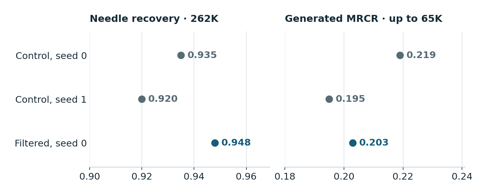

During Snowball fine-tuning, we replaced long replay documents that a filter flagged as data dumps or machine output. After 238 updates, the filtered checkpoint scored higher than both unfiltered controls on a 262K-token retrieval probe that scored a supplied answer. On a benchmark that asked the same checkpoints to generate the answer, the filtered checkpoint scored 0.203. The controls scored 0.219 and 0.195.

[Marin data audit](https://github.com/marin-community/marin/issues/11188) · [Logbook issue](https://github.com/marin-community/marin-logbooks/issues/40) · [Final experiment record](https://github.com/marin-community/marin-logbooks/blob/028da3f4b04b34ddb5ac85f7d8033263c3407001/logbooks/40-lce-replay-junk-filter/notebook.md#final-decision)

## Replay selection

The supervised fine-tuning mix for Snowball, Marin’s 67B mixture-of-experts model, includes pretraining text alongside demonstrations. This replay makes up about a fifth of training positions, mostly from long documents. An earlier Snowball run had lost ground on a long-context retrieval probe after fine-tuning. We tested whether replacing data dumps and machine output with other long documents would help. [Earlier retrieval comparison](https://github.com/marin-community/marin/issues/9519)

The filter looked for patterns such as encoded blobs, minified code, and repetitive structured data in eight sampled windows per document. It flagged 30% of the tokens in the control’s long replay. We refilled each group of documents from the same source cluster and quality tier to its target token budget. The replacement changed about 5% of all training positions. We trained one filtered run and one unfiltered run from the same seed, then repeated the unfiltered run with a second seed. [Training setup and treatment dose](https://github.com/marin-community/marin-logbooks/blob/028da3f4b04b34ddb5ac85f7d8033263c3407001/logbooks/40-lce-replay-junk-filter/notebook.md#2026-11-13-0440-utc---filtered-long-replay-built-both-arms-launched) · [Second control run](https://github.com/marin-community/marin-logbooks/blob/028da3f4b04b34ddb5ac85f7d8033263c3407001/logbooks/40-lce-replay-junk-filter/notebook.md#2026-11-15-0130-utc---seed-replicate-of-the-control-arm)

## Retrieval results

Multi-Round Coreference Resolution (MRCR) repeats a request in a long conversation and asks for the reply from a particular occurrence. To score a supplied reply, we measure how much removing the earlier matching turns raises the loss on that reply. Needle recovery divides that loss change in the long prompt by the loss change in a short prompt. A score of 1 means the matching turns help equally in both settings. During scoring, the model receives the preceding tokens from the reference reply. If its first words identify the requested occurrence, they can help the model predict the rest. In the generative test, the model must select the occurrence and produce the reply itself. The benchmark scores text similarity to the reference. [Retrieval probe design](https://github.com/marin-community/marin/issues/8701) · [Evaluation comparison](https://github.com/marin-community/marin-logbooks/blob/028da3f4b04b34ddb5ac85f7d8033263c3407001/logbooks/40-lce-replay-junk-filter/notebook.md#2026-11-17-2340-utc---needle-recovery-is-a-likelihood-diagnostic-not-the-mrcr-benchmark-score)

*Scores for the three step-238 checkpoints. The panels have different horizontal scales. All checkpoints generated an answer for each of the same 901 benchmark items. [Results](https://github.com/marin-community/marin-logbooks/blob/028da3f4b04b34ddb5ac85f7d8033263c3407001/logbooks/40-lce-replay-junk-filter/notebook.md#2026-11-18-0130-utc---generative-mrcr-65k-on-the-step-238-checkpoints) · [Item-count correction](https://github.com/marin-community/marin-logbooks/blob/028da3f4b04b34ddb5ac85f7d8033263c3407001/logbooks/40-lce-replay-junk-filter/notebook.md#2026-11-18-0230-utc---correction-no-mrcr-items-were-dropped)*

The paired 95% bootstrap interval for the generated-answer score difference between the filtered run and the control mean was −0.021 to +0.012 across items. One filtered run leaves training-seed variation unresolved. The two evaluations used different context limits, so the experiment leaves open how much the ranking depends on the scoring method and how much it depends on context length. The experiment record recommends using the filter for data cleanup. [Final decision and limits](https://github.com/marin-community/marin-logbooks/blob/028da3f4b04b34ddb5ac85f7d8033263c3407001/logbooks/40-lce-replay-junk-filter/notebook.md#final-decision)
