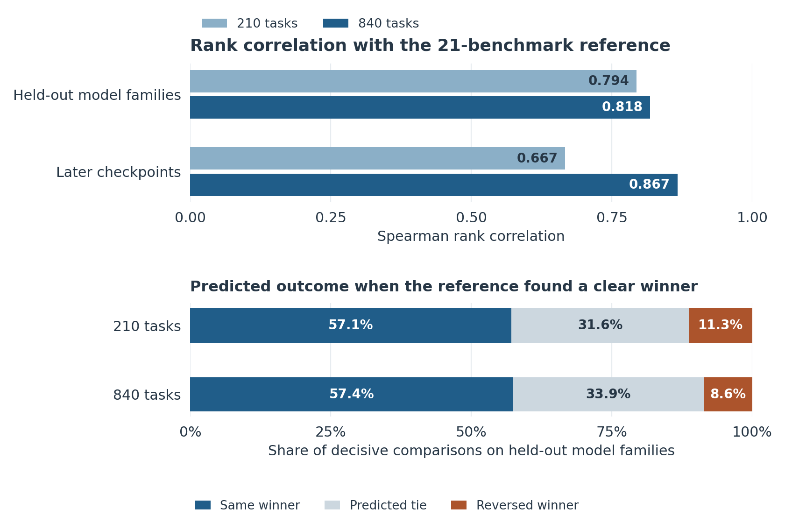

We wanted a small evaluation we could run during reinforcement learning to see which checkpoints deserved a full run. We tested whether 840 randomly selected tasks could recover the results from running every task in 21 benchmarks. On historical data, a predictor using the sampled tasks reached a Spearman rank correlation of 0.818 with the reference ranking. It preserved the winner in 57.4% of benchmark comparisons where the reference scores gave one model a clear win. [Results and error analysis](https://huggingface.co/datasets/open-athena/Marin-Mini-Eval-Policy-Index/blob/d5d2f92ce4866c431063bd123ea31a3865530809/analysis/RANDOM_SUBSET_ERROR_ANALYSIS.md)

[Marin experiment #10804](https://github.com/marin-community/marin/issues/10804) · [Full evaluation policy](https://github.com/marin-community/marin/issues/10197)

## Approach

We drew tasks at random within 21 of the 26 policy benchmarks. A task was a dataset example or an agent scenario. Mini840 included all 210 tasks in Micro210. Prescribed repeat attempts stayed with each task, so the rollout count could exceed the task count. We fitted a ridge regression to predict each benchmark's score across all its tasks. For both the predicted and reference rankings, we gave each model one point for a benchmark win over another model, half a point for a tie and zero for a loss. We averaged points equally across opponents and benchmarks. [Study design](https://github.com/marin-community/marin/issues/10804#scope-and-experimental-design)

The main test used 18 historical models. We split them into four groups that kept related model families together. For each split, we chose tasks and fitted the predictor using three groups, then predicted scores for the fourth. For each of three random draws, we pooled the held-out predictions into one ranking and then averaged the resulting correlations. A second test evaluated four later checkpoints from Marin's Snowball model series. [Holdout definitions](https://huggingface.co/datasets/open-athena/Marin-Mini-Eval-Policy-Index/blob/d5d2f92ce4866c431063bd123ea31a3865530809/analysis/study-20261030-v6-21x21/report/COST_COMPARISON.md)

## Results

Stratified random sampling gave the lowest mean absolute error at both budgets. This measures how far the predicted benchmark scores were from the reference scores in either direction. At 840 tasks the mean absolute error was 8.21 percentage points on the family holdout. A mutual-information selector ranked models slightly better, with a correlation of 0.847, and had a larger mean absolute error of 8.93 points. The simpler random selector became our default. [Selector comparison](https://huggingface.co/datasets/open-athena/Marin-Mini-Eval-Policy-Index/blob/d5d2f92ce4866c431063bd123ea31a3865530809/analysis/study-20261030-v6-21x21/report/COST_COMPARISON.md)

We called a model pair decisive on a benchmark if the score gap exceeded a threshold based on the two scores' standard errors. For the predicted scores, we used the benchmark's median standard error from training data. Among comparisons that were decisive in the reference, the share with a reversed winner fell from 11.3% at 210 tasks to 8.6% at 840. Predicted ties accounted for most misses at both budgets. At 840 tasks, the predictor overestimated benchmark scores for the bottom six models by 5.49 points on average and underestimated scores for the top six by 3.70 points. [Pair outcomes and score errors](https://huggingface.co/datasets/open-athena/Marin-Mini-Eval-Policy-Index/blob/d5d2f92ce4866c431063bd123ea31a3865530809/analysis/RANDOM_SUBSET_ERROR_ANALYSIS.md#ties-and-reversed-winners)

*Top, Spearman correlation of the predicted and reference rankings. Bottom, predicted outcomes for pairs with a clear winner in the 21-benchmark reference, across three random draws on the 18-model family holdout. Percentages are rounded independently. [Ranking data](https://huggingface.co/datasets/open-athena/Marin-Mini-Eval-Policy-Index/blob/d5d2f92ce4866c431063bd123ea31a3865530809/analysis/study-20261030-v6-21x21/report/COST_COMPARISON.md) · [Pair outcomes](https://huggingface.co/datasets/open-athena/Marin-Mini-Eval-Policy-Index/blob/d5d2f92ce4866c431063bd123ea31a3865530809/analysis/RANDOM_SUBSET_ERROR_ANALYSIS.md#ties-and-reversed-winners)*

## Released validation sets

[Mini840](https://huggingface.co/datasets/open-athena/Marin-Mini-Eval-840/tree/bae388a44fc0ba9ffa551a4c6347fbe03a9fefd7) and [Micro210](https://huggingface.co/datasets/open-athena/Marin-Micro-Eval-210/tree/4564ed081c316bc3231ae5c3a53a46b39248c819) report raw task rewards and omit the fitted predictor. They also use a single agent harness and common token limits across benchmarks. How well those raw scores track the full policy on new checkpoints is still open. Whole-suite GPU-hour savings also remain unmeasured. We released the compact sets for training feedback and kept the full evaluation for release decisions. [Validation follow-up](https://github.com/marin-community/marin/issues/10933)
