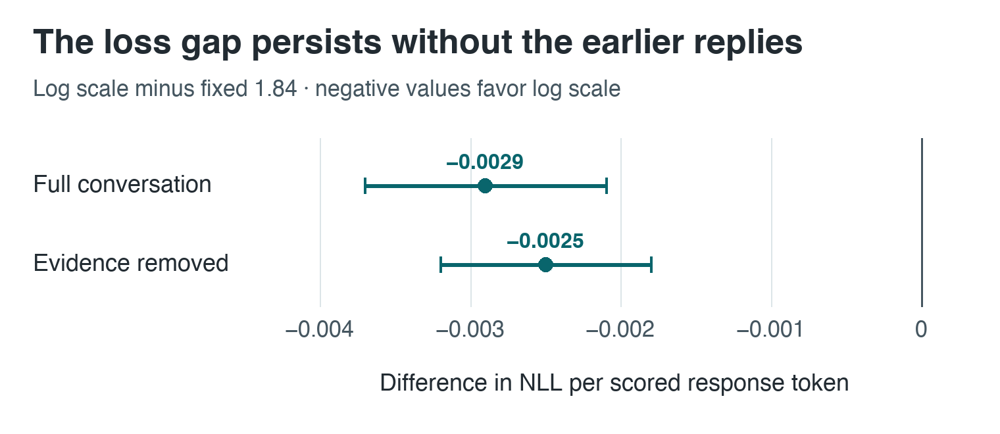

Did lower loss on a 262K retrieval test mean Mochi made better use of earlier replies? We compared two attention recipes for Marin’s 535B-parameter mixture-of-experts model. After 149.5B training tokens per recipe, log scaling lowered the full-context loss from 0.0252 to 0.0223 compared with a fixed scale. Most of that gap remained when we removed the earlier replies from the prompt and scored the same target reply. [Finalist results](https://github.com/marin-community/marin-logbooks/issues/37#issuecomment-6751602983)

[Mochi training issue](https://github.com/marin-community/marin/issues/8435) · [262K recipe study](https://github.com/marin-community/marin-logbooks/issues/37) · [Paired retrieval evaluation design](https://github.com/marin-community/marin/issues/8701)

## Attention scaling

A global attention layer can attend to the entire preceding document. As the context grows, the relevant tokens compete with more candidates. Multiplying the attention query by a larger number sharpens the distribution. We compared a fixed global multiplier of 1.84, which followed the previous context-extension schedule, with a global multiplier that stays at 1.66 up to 65K visible keys and rises on a log curve to 2.15 at 262K keys. These are two complete recipes with different scales even on short prompts. [Architecture background](https://openathena.ai/blog/marin-535b-architecture/) · [Log scaling implementation](https://github.com/marin-community/marin/pull/10986)

Short runs showed some separation in retrieval-test loss and little separation on held-out text. To see whether that pattern persisted, we trained both finalists from the same averaged 65K checkpoint and used the same data in the same order. [Short-run notebook](https://github.com/marin-community/marin-logbooks/blob/c8d822969a7734d33e76406d7e133af94e41da73/logbooks/37-hero-262k/notebook.md) · [Fixed scale run](https://wandb.ai/marin-community/marin_moe/runs/hero-lce-global184-step390k) · [Log scale run](https://wandb.ai/marin-community/marin_moe/runs/hero-lce-log65536sq-step390k)

## Retrieval evaluation

In OpenAI’s Multi-Round Coreference Resolution (MRCR) benchmark, the same request appears several times in a long conversation and the final query asks for a specific earlier reply. The full-context condition showed the model the entire conversation. In the other, we removed each earlier occurrence of the repeated request and its corresponding reply. The other turns, final query and scored target stayed the same. Removing turns shortened the prompt and could change the multiplier for a query under log scaling. [Prompt construction](https://github.com/marin-community/marin/blob/1b113f404c009d197491eab19bf686103f4e99fb/experiments/datasets/mrcr.py#L180-L225)

We used teacher forcing. At each step we scored the next token of the reference reply given the preceding reference tokens. This measures how probable the target reply was. A generation evaluation would show how often the models returned the requested reply on their own. [Scoring design](https://github.com/marin-community/marin/issues/8701)

## Results

Log scaling reduced final negative log-likelihood (NLL) by 0.0029 with the full prompt and by 0.0025 with the retrieval evidence removed. Full-context loss alone leaves open how much of the gap comes from using the earlier replies. Recovery compares how much restoring the relevant turns lowers loss in the long conversation with how much adding them lowers loss when the prompt has only the final query. The change in recovery was +0.0010, with a paired 95% interval of −0.0001 to +0.0021. Held-out text loss was similar at 1.6433 for the fixed recipe and 1.6434 for log scaling. [Finalist results](https://github.com/marin-community/marin-logbooks/issues/37#issuecomment-6751602983) · [Recovery metric](https://github.com/marin-community/marin/blob/1b113f404c009d197491eab19bf686103f4e99fb/experiments/grug/moe_hero_ep/mrcr_eval.py#L143-L174)

*Final MRCR loss difference for the same target replies, log scale minus fixed 1.84. The 95% paired bootstrap intervals describe variation across 299 conversations. Each recipe ran once. [Source](https://github.com/marin-community/marin-logbooks/issues/37#issuecomment-6751602983)*

We adopted the log-scaled checkpoint for downstream training. The intervals cover the choice of evaluation conversations. Replicated training runs would show how much the loss differences vary across runs. [Recipe decision](https://github.com/marin-community/marin/pull/11044)
