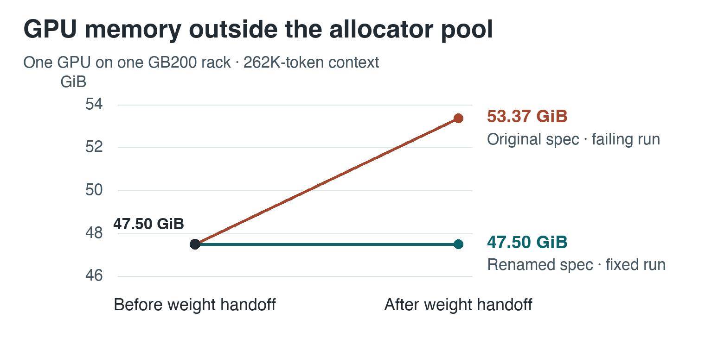

At 262K context on one GB200 rack, Mochi ran out of GPU memory on the first training step after evaluation. The allocator pool had returned to its earlier footprint. The handoff to evaluation had created a GPU communication group whose buffers stayed live. Keeping each weight shard on its original device eliminated that allocation and let training resume. [Failure and fix](https://github.com/marin-community/marin/pull/10994)

[Mochi training issue](https://github.com/marin-community/marin/issues/8435) · [262K logbook issue](https://github.com/marin-community/marin-logbooks/issues/37)

## Training and evaluation layouts

Mochi is a mixture-of-experts model. It routes each token to a small set of expert networks, whose weights are split across GPUs. For training, the GPU layout has an `expert` axis that distributes these weights. The evaluation layout folds `expert` into `data` so evaluation can score all routed assignments, including those that would exceed training’s per-expert capacity. [Expert parallelism background](https://openathena.ai/blog/expert-parallelism/) · [Evaluation mesh code](https://github.com/marin-community/marin/blob/9d9f9af5797484eea0d2d58aa9477d31f381db28/experiments/grug/moe_hero_ep/train.py#L508-L569)

Consider a weight split into shards A and B across two GPUs. After the axis fold, `expert` has size one, so reusing the old sharding specification calls for a replica of the full weight on each GPU. An all-gather exchanges the shards so both GPUs have A and B. In the failing run the exchange opened an NCCL communicator, a group of GPUs set up to run collectives. Its buffers outlived evaluation and left too little room for the first resumed training step. [Handoff diagnosis](https://github.com/marin-community/marin/pull/10994)

The training `data` axis had size one. Dropping it from the sharding specification and renaming `expert` to evaluation’s `data` described the same physical placement on the new mesh. This kept both shards in place and avoided the exchange. The rename relies on that correspondence between layouts. [Sharding change](https://github.com/marin-community/marin/pull/10994/files)

*The two-GPU example shows weight placement during the handoff to evaluation.*

## GPU memory at the handoff

We estimated memory outside the allocator pool by subtracting the reserved pool from total GPU memory in use. During the failing handoff, that measure rose 5.87 GiB on the measured GPU. NCCL logged 5.63 GiB of new buffers. The first resumed step was 1.62 GiB short of the memory it needed. With the rename, the measure stayed flat at the handoff and training resumed after two evaluations on the same rack-scale setup. [Memory accounting](https://github.com/marin-community/marin/blob/e8e58b910dff46c77454ac207852c7b8345037c2/experiments/grug/moe_hero_ep/device_memory_probe.py#L24-L43) · [One-rack measurements](https://github.com/marin-community/marin/pull/10994)

*GPU rank 0, before and after the weight handoff in separate one-rack runs at 262K. The first evaluation forward pass comes after these measurements. [Source](https://github.com/marin-community/marin/pull/10994)*

The 11-rack follow-up also found a flat handoff. The first evaluation forward pass then opened a different communicator and added about 1 GiB per GPU. To locate a similar allocation, record total used and allocator-reserved memory across the weight handoff, first evaluation forward pass and training resume. Compare the physical shard placement on each side of the handoff to see whether the layout requires an exchange. [Eleven-rack measurements](https://github.com/marin-community/marin/commit/9d9f9af5797484eea0d2d58aa9477d31f381db28)
