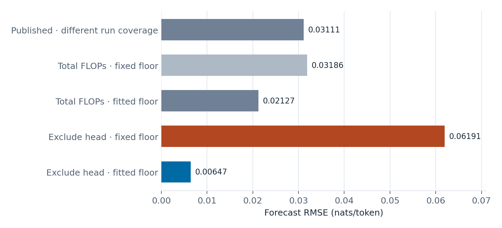

The published forecast put Uncheatable validation loss too high at all 46 checkpoints we scored during the 4K training phase of Mochi, Marin’s mixture-of-experts model with 535 billion total parameters. We compared four refits on smaller runs. Excluding output-head FLOPs and fitting the loss floor gave the lowest root mean squared error on the same 46 evaluations, 0.00647 versus 0.03111 nats per token for the published forecast. Excluding the head FLOPs while keeping the old floor made the error worse.

[Marin scaling ladder #8435](https://github.com/marin-community/marin/issues/8435) · [Logbook #8](https://github.com/marin-community/marin-logbooks/issues/8)

## Approach

Uncheatable loss averages next-token cross-entropy over seven evaluation subsets. We took checkpoints at the same training fraction across a ladder of smaller runs. For example, we fit the half-trained checkpoints against the compute each had used by halfway, then evaluated that curve at the compute Mochi would use by halfway. We interpolated between the resulting forecasts at the fractions where Mochi logged evaluations. Each curve treats loss as a floor plus a term that falls as a power of compute. Subtracting the floor and taking logs produces a line against log compute. Moving the floor can change the fitted slope and thus the extrapolation. [Method and frozen inputs](https://github.com/marin-community/marin-logbooks/blob/817a83de0db7fd0b6577c2b60733bd1c786e4967/logbooks/8-hero-uncheatable-forecast/notebook.md#2026-10-25-narrow-the-comparison-to-palomas-method)

Our forecast for [Paloma](https://arxiv.org/abs/2312.10523), a language-modeling benchmark across English and code, excluded the output head that maps hidden states to vocabulary logits. To see what carried over to Uncheatable, we used the same smaller runs for four refits. We counted compute with or without the output head and either fixed the loss floor at the original 1.4 or chose a common floor across training fractions by minimizing squared error on the ladder losses. We scored the already published forecast separately because its run coverage differed. [Forecast code and errors](https://github.com/marin-community/marin-logbooks/blob/817a83de0db7fd0b6577c2b60733bd1c786e4967/logbooks/8-hero-uncheatable-forecast/method-results.json)

## Results

With total compute, fitting the floor reduced the error from 0.03186 to 0.02127. With the output head excluded, holding the floor at 1.4 raised the error to 0.06191. Fitting the floor on that compute axis yielded the lowest error of the four refits.

*We scored the published forecast and all four refits on the same 46 Mochi checkpoints before training switched from 4K to 16K. Each evaluation also packed tokens into 4K sequences. The refits share the same small-run data. The published forecast used different ladder coverage.*

## The Paloma comparison

On Paloma, the floor estimated from its original TPU ladder fit the ladder better and forecast Mochi worse. Its error rose from 0.00866 with the historical 1.5 floor to 0.02393 with the TPU-only fitted floor. Fitting a common floor from the TPU ladder and earlier Delphi results, with equal weight per family, restored about the original forecast accuracy at 0.00859. [Paloma ladder and historical fits](https://github.com/marin-community/marin-logbooks/blob/817a83de0db7fd0b6577c2b60733bd1c786e4967/logbooks/8-hero-uncheatable-forecast/notebook.md#2026-10-25-shared-historical-floor-with-hero-left-out)

Mochi’s losses served only as a retrospective score for the tested methods. The comparison covers one pretraining run at 4K evaluation packing and averages across Uncheatable subsets. It leaves later context lengths and individual subset forecasts open.
