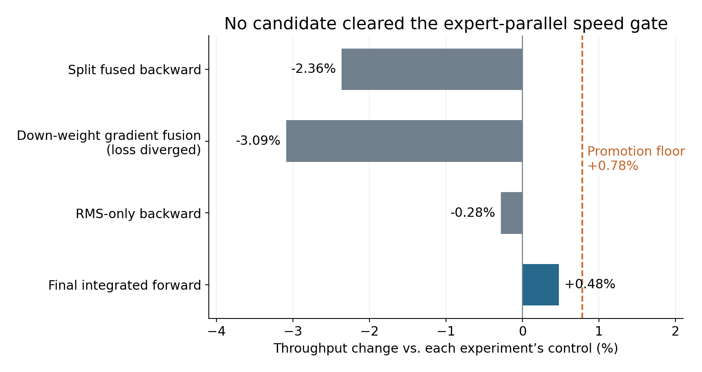

We tried to accelerate Grug's RMS normalization and gated feed-forward computation with fused GPU kernels. In the final concurrent comparison on 64 GB200 GPUs, the treatment increased throughput by 0.48% and peak memory by 7.34 GiB per GPU. Its gain was below the experiment's 0.78% promotion threshold, and one gradient missed the numerical acceptance threshold. We kept the implementation as a research record. [Final expert-parallel result](https://github.com/marin-community/marin/issues/8152)

[Marin experiment #8152](https://github.com/marin-community/marin/issues/8152) · [Research PR #8153](https://github.com/marin-community/marin/pull/8153)

## Approach

RMS normalization rescales an activation vector by its root-mean-square magnitude. Grug also gates the feed-forward output using another learned projection. Computing those operations and their gradients in separate kernels can require writing large intermediates to GPU memory and reading them again.

The fusion experiment moved parts of that work into matrix-multiply kernels. The intended benefit was to compute normalization-gradient terms while the matrix multiply already had the needed values. An earlier fully sharded training comparison showed a throughput gain. The target for adoption was the expert-parallel model, where experts are distributed across GPUs and the memory budget differs. [Experiment scope and initial measurements](https://github.com/marin-community/marin/blob/13ddefe6d215ef7aaf06e3de1e57d15a0568324f/.agents/logbooks/grug-moe-coda-rms.md)

The experiment adopted a 0.78% throughput floor from an earlier rack comparison in which byte-identical arms differed by that much under different placements. This was a screening rule, with limited resolution for small gains. [Measurement protocol](https://github.com/marin-community/marin/blob/b67e6bca46bc91aaee39102bb66178e7ff61fd0b/experiments/grug/moe_hero_fsdp/sweep.py)

On the expert-parallel target, full-width tensors crossing custom-call boundaries, where the compiler cannot optimize across the kernel, added scratch memory. A split fused backward treatment fit but ran slower. Fusing a smaller region saved memory and also ran slower. We then tested an integrated forward treatment that removed additional intermediates.

## Results

*Each candidate is compared with its recorded XLA control on the expert-parallel workload. These are separate experiments. The weight-gradient fusion also developed loss divergence. [Pinned result ledger](https://github.com/marin-community/marin/blob/13ddefe6d215ef7aaf06e3de1e57d15a0568324f/.agents/logbooks/grug-moe-coda-rms.md)*

The integrated treatment initially ran out of memory. Reducing the communication staging buffer from 1 MiB to 256 KiB let it train. The final tuned control and treatment both used the smaller buffer, each completed 25 steps, and were scored over steps 5–24. Median throughput was 246,475 versus 247,654 tokens per second. Peak memory rose from 174.221 to 181.565 GiB per GPU.

A separate four-GPU comparison against XLA put the up-projection weight-gradient scaled error at 1.149%, above the strict 1.0% limit. The check divides the maximum absolute difference by the reference tensor's maximum absolute value, with a denominator floor of 0.000001. [Numerical check](https://github.com/marin-community/marin/blob/b67e6bca46bc91aaee39102bb66178e7ff61fd0b/lib/levanter/tests/grug/test_quack_rms_cute.py) The other checked outputs and gradients passed. The small throughput margin, extra memory, and numerical near miss together failed the adoption criteria. The smaller communication buffer solved the measured fit problem; it did not make this fused implementation a sufficient production improvement. [Final measurements and numerical gate](https://github.com/marin-community/marin/issues/8152)
