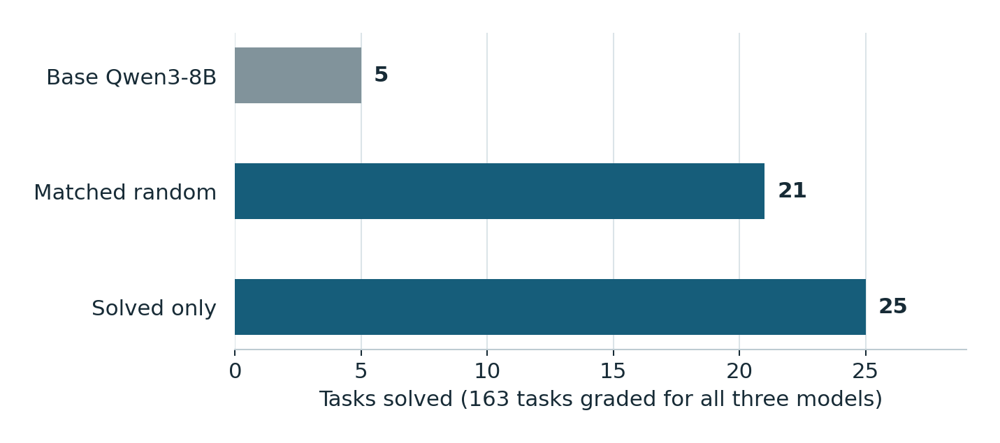

We fine-tuned Qwen3-8B on Open-SWE traces that solved their tasks and compared it with a fine-tune on a source-matched random sample of the same token volume. On 163 SWE-bench Verified tasks graded for all three checkpoints, the solved-only model solved 25, the random-sample model solved 21, and base Qwen3-8B solved five. The four-task lead over matched random sampling was inconclusive.

[Marin filtering proposal](https://github.com/marin-community/marin/pull/10813) · [Logbook issue](https://github.com/marin-community/marin-logbooks/issues/39)

## Training sets

Open-SWE-Traces records the messages, tool calls, and tool results of coding agents. Some traces carry a label indicating whether the agent solved the task. Filtering to solved traces changes both which outcomes the model sees and how much training text it gets from each source. We wanted to measure the value of the outcome filter at a fixed token budget. [Dataset card](https://huggingface.co/datasets/nvidia/Open-SWE-Traces)

Each fine-tune started from base Qwen3-8B and trained for one pass over about 426 million tokens. The solved-only set contained 10,000 traces. The matched random set contained 9,504 traces, of which 48% were labeled solved. Token volume was matched within each source partition to preserve the mix of generating agents, models, and task sources. Both sets used the message and tool-call protocol of Terminus-2, the terminal agent used to evaluate the models. [Data construction and training](https://github.com/marin-community/marin-logbooks/blob/e956e9f37c21915f59332bb2652768489d9e083f/logbooks/39-open-swe-outcome/notebook.md#qwen3-8b-trained-in-the-terminus-2-format)

## SWE-bench results

All three checkpoints attempted the same 200 repository tasks. SWE-bench Verified uses tests to grade the proposed patch. Infrastructure errors left some tasks without grades even after retries. The comparison with the base model uses the 163 tasks with a grade for every checkpoint. [Final evaluation](https://github.com/marin-community/marin-logbooks/blob/e956e9f37c21915f59332bb2652768489d9e083f/logbooks/39-open-swe-outcome/notebook.md#2026-11-19-2230-utc---retry-of-ungraded-trials)

*Solves on the 163 tasks graded for all three checkpoints after infrastructure retries.*

The direct comparison between the two fine-tunes uses the 170 tasks for which both had grades. The solved-only model won 15 of the tasks on which their outcomes differed. The matched random model won 11. An exact paired sign test gave p = 0.56. Each fine-tune used one seed. Repeated evaluations of the same checkpoint would estimate how much the solve count varies even when the weights stay fixed. [Paired results](https://github.com/marin-community/marin-logbooks/blob/e956e9f37c21915f59332bb2652768489d9e083f/logbooks/39-open-swe-outcome/notebook.md#2026-11-19-2230-utc---retry-of-ungraded-trials)

## Held-out traces

The solved-only model’s loss on held-out successful traces was 0.0005 nats per assistant token higher than the random model’s. We also asked whether the difference between the models’ mean log probabilities per assistant token could distinguish a successful trace from a failed one. We paired attempts on the same task from the same agent and generating model to control for task difficulty and style. The score ranked the successful trace higher in 55.7% of the 210 pairs, with a 95% interval of 48.6% to 62.9%. A 50% win rate falls inside that interval. [Held-out results](https://github.com/marin-community/marin-logbooks/blob/e956e9f37c21915f59332bb2652768489d9e083f/logbooks/39-open-swe-outcome/notebook.md#2026-11-19-1730-utc---held-out-loss-and-outcome-discrimination-terminus-checkpoints)
