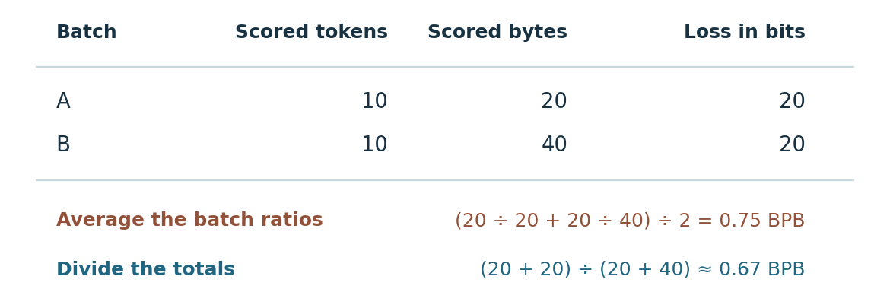
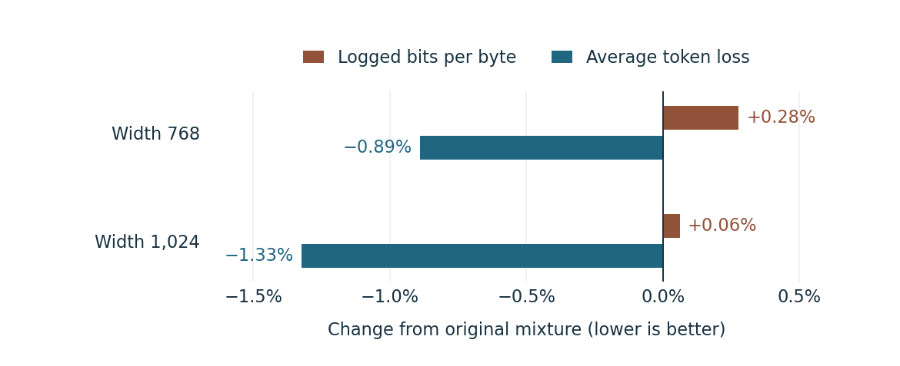

When we compared a new pretraining data mix with the original mix, our bits-per-byte scores suggested the new mix hurt code prediction at two model widths. A later audit found the opposite on the same scored text. Average token loss fell by 0.89% at hidden width 768 and 1.33% at hidden width 1,024. The evaluation batches had different sizes, and Levanter's aggregation made the reported bits per byte depend on how the text was batched. [Final evaluation data](https://storage.googleapis.com/marin-public/held/h100-mix25-paloma/final-2026.09.15.1/point_speedups.csv)

[Marin experiment #9126](https://github.com/marin-community/marin/issues/9126) · [Levanter audit #10968](https://github.com/marin-community/marin/issues/10968)

## Background

Before switching the data mix on a large training run, we compared the old and proposed mixes on smaller models at matched training compute. The comparison runs trained the first quarter on the original mix, then switched to the proposed mix. The recipes also differed in hardware and some training settings. [Original comparison](https://github.com/marin-community/marin/issues/9126)

One check was how well the final models predicted code on Paloma's 100-programming-languages subset. The final evaluations batched 64 versus 16 sequences at width 768, and 128 versus 32 at width 1,024, for the original and new mixtures respectively. The tokenizer and scored text windows were the same within each pair. [Evaluation run records](https://storage.googleapis.com/marin-public/held/h100-mix25-paloma/final-2026.09.15.1/coverage.csv)

## How the metric was computed

Bits per byte (BPB) divides the total prediction loss in bits by the number of scored bytes. The audited evaluator computed BPB for each batch and averaged those ratios, giving each batch weight proportional to its number of scored tokens. That works if every batch has the same number of bytes per token. Code tokens can span different numbers of bytes, so the weighting gives some bytes more influence than others. [Levanter aggregation code](https://github.com/marin-community/marin/blob/eac658e3423c984926f3335179d3fccf6d926beb/lib/levanter/src/levanter/eval.py#L573-L591)

Take two batches of ten tokens each. Both have a total loss of 20 bits, but the first covers 20 bytes and the second covers 40. The evaluator gives their ratios of 1.0 and 0.5 equal weight and reports 0.75 BPB. Combine the tokens into one batch and it reports 40 bits divided by 60 bytes, or about 0.67 BPB. Summing bits and bytes separately gives the same answer under either batching.

*Worked example with fixed token predictions and 60 scored bytes.*

## Results

*Percent change from the original mixture to the new mixture on Paloma's 100-programming-languages subset at matched training compute. Lower is better. Each width shows one pair of final evaluations. [Source data](https://storage.googleapis.com/marin-public/held/h100-mix25-paloma/final-2026.09.15.1/point_speedups.csv)*

Average token loss sums the losses and divides by the number of scored tokens. Correctly aggregated BPB uses the same sum, converted to bits, and divides by bytes instead. With the tokenizer and scored windows fixed, those denominators are constant across the two runs. Both metrics therefore change by the same percentage. The loss results establish the direction and relative size of the correction on these windows. Absolute BPB values would require verified byte counts. [Open evaluator audit](https://github.com/marin-community/marin/issues/10968)
