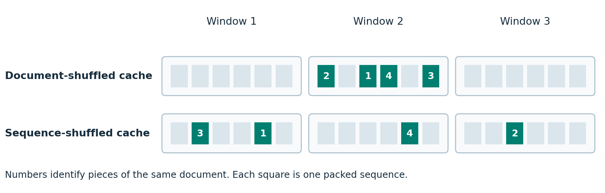
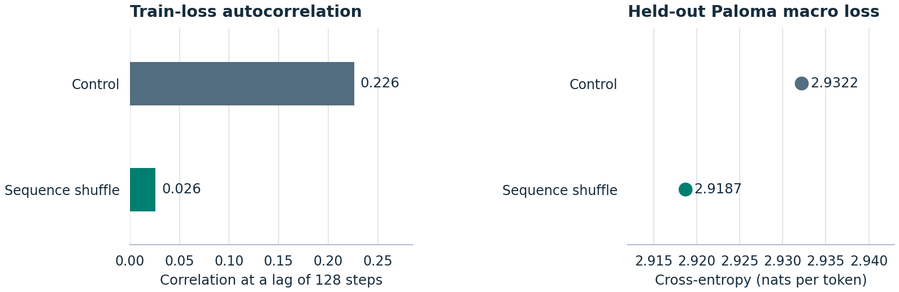

In one Marin pretraining run, the loss curve had a sawtooth with a period of 128 steps. At step 5,504, the start of a new data window, loss jumped by 0.11. We rewrote the training cache in a different order and ran a paired test on a smaller model. The correlation between losses 128 steps apart fell from 0.226 to 0.026, and held-out Paloma macro loss fell from 2.9322 to 2.9187. [Experiment record](https://github.com/marin-community/marin/issues/10412) · [Run with the original sawtooth](https://wandb.ai/marin-community/marin_moe/runs/s7l-d1280L16)

## Why 128 steps?

The cache stored tokenized documents in shuffled order. The loader read them as one token stream cut into 4,096-token sequences. If a document is 16,384 tokens and starts at a sequence boundary, its four pieces become consecutive training examples. A little over half the tokens in this cache came from documents longer than one sequence. [Experiment record](https://github.com/marin-community/marin/issues/10412)

The loader shuffles blocks of 256 consecutive sequences across the cache for efficient reads. It then shuffles individual sequences within each group of 512 blocks. If those four pieces land in the same block, all four reach the model in one window. At a global batch size of 1,024 sequences, that window is 256 × 512 ÷ 1,024 = 128 updates long. Our explanation is that the model adapts to some of the material within a window, then sees less familiar material when the window changes. [Block shuffle at the measured revision](https://github.com/marin-community/marin/blob/a5a8647840bbf1f56fdc37d177097fc4667ecdb2/lib/levanter/src/levanter/data/dataset.py#L383) · [Default window settings](https://github.com/marin-community/marin/blob/a5a8647840bbf1f56fdc37d177097fc4667ecdb2/lib/levanter/src/levanter/data/text/datasets.py#L565)

## Changing the cache order

We took the sequence boundaries the loader already used and randomly reordered the roughly 30 million complete sequences when writing the new cache. That lets pieces of a long document land in different blocks and different windows. The training loader still uses the same block shuffle. Each packed sequence contains the same tokens as before. [Cache rewrite and validation](https://github.com/marin-community/marin/blob/e53d6b0620/experiments/grug/fast_track/seq_shuffle_cache.py)

*The four labeled pieces come from one example document. Both rows show the order after the loader's within-window shuffle. Each outlined window contains 131,072 sequences in the experiment.*

## Paired result

We ran each cache for 1,346 steps from the same seed on a width-512 model, with 1,024 sequences per step. The lag-128 correlation dropped by 0.200, and Paloma macro loss, the average held-out loss across Paloma subsets, improved by 0.0135. The paired runs used one seed. The size of the loss gain across seeds, batch sizes and model widths is still open. [Control run](https://wandb.ai/marin-community/marin_moe/runs/saw5-ctl) · [Sequence-shuffled run](https://wandb.ai/marin-community/marin_moe/runs/saw5-seq) · [Comparison and limits](https://github.com/marin-community/marin/issues/10412)

*Both metrics come from the same width-512 pair. The lag is the length of one full shuffle window at batch 1,024.*
