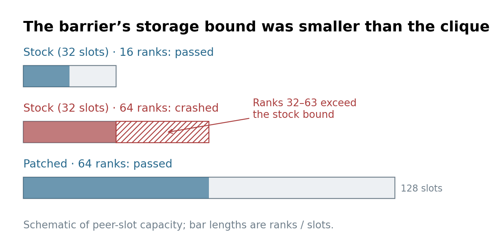

A ragged all-to-all collective worked on 16 GPUs and crashed on 64 in Marin's GB200 training tests. The affected runtime launched a barrier for 64 ranks using a layout sized for 32 peers. Rebuilding the runtime with 128 peer slots removed the crash in the recorded case and let the expert-parallel model complete 25 training steps. [Upstream reproduction and patch validation](https://github.com/openxla/xla/issues/47283)

[Marin experiment #8077](https://github.com/marin-community/marin/issues/8077)

## Background

Expert parallelism distributes a model's experts across GPUs. Each GPU sends a different number of token representations to each peer, so the exchange is ragged. The one-shot implementation uses memory visible across the high-bandwidth GPU domain and a barrier to coordinate access.

The barrier needs signal storage for the participating ranks. At the measured XLA revision, two barrier kernel variants declared a maximum of 32 peers. One launcher rejected a larger clique. The NCCL-window launcher selected by this ragged all-to-all path had no equivalent bounds check. [Pinned barrier layout and launch paths](https://github.com/openxla/xla/issues/47283#root-cause-hypothesis)

## Failure and validation

A clique is the participating GPU group; each rank corresponded to one GPU in these tests. On the 64-rank clique, ranks could index beyond the 32-slot signal region. The observed result was `CUDA_ERROR_ILLEGAL_ADDRESS` on the first collective execution. The training failure reproduced in five of five runs. A standalone program on the stock JAX nightly also crashed with 64 devices and passed with 16. The reproduction required a GPU memory domain large enough to exercise the affected path. [Minimal reproduction](https://github.com/openxla/xla/issues/47283#minimal-repro)

*The affected launch passed the clique size to a kernel whose signal layout used the smaller compile-time bound. [Source diagnosis](https://github.com/openxla/xla/issues/47283#root-cause-hypothesis)*

We rebuilt `jax-cuda13-pjrt` at the August 11 nightly pins with the peer bound changed from 32 to 128. A 64-GPU, 384-expert, top-8 training benchmark then completed 25 steps. At 16 ranks, the patched runtime measured 22.48% model FLOP utilization versus 22.46% for stock. That smaller case supplied a regression comparison below the old bound. [Fix validation](https://github.com/openxla/xla/issues/47283#fix-validation)

The validation used GB200 NVL72 hardware, CUDA 13, and NCCL 2.30.7. The short benchmark established that the rebuilt barrier handled this clique and workload. The patch retains a finite 128-peer bound. Its utilization measurement does not characterize a full production training run. The pinned reproduction and upstream report preserve the case for runtime maintainers. [Environment and source revisions](https://github.com/openxla/xla/issues/47283#environment)
