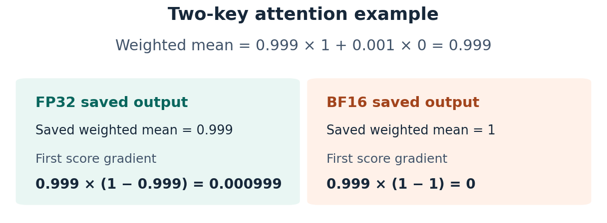
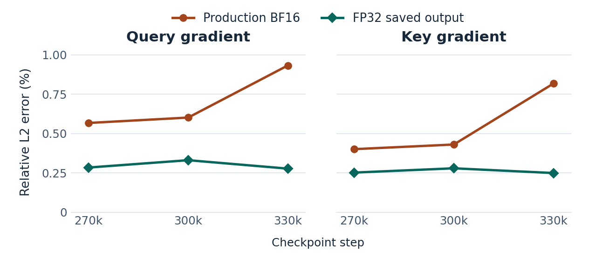

Mochi's production attention kernel passes a BF16 output to the rest of the model and reuses it in backward. We tested a kernel that still returns BF16. It saves a separate FP32 copy of the output before rounding and uses that copy in backward. Query and key gradient errors fell at all three frozen 16K checkpoints. At step 330,000, the errors fell from 0.93% and 0.82% to 0.28% and 0.25% in relative L2 norm. The FP64 reference used the same quantized inputs and the same gradients arriving from the rest of the model. [Comparison report](https://github.com/marin-community/marin-logbooks/blob/639890bd78bf2455624bc5ad3f105f0f1d8d2a9e/logbooks/12-hero-attention-softmax/mitigation-comparison-report.md)

[Mochi training issue](https://github.com/marin-community/marin/issues/8506) · [Attention diagnostic logbook](https://github.com/marin-community/marin-logbooks/issues/12)

## Background

We started by checking rounding in Mochi's output loss, then looked for a similar problem inside attention. Each attention score is a scaled dot product of a query and a key. Softmax turns those scores into weights, and the attention output `O` is the weighted mean of the value vectors. Increasing a key's score shifts `O` toward that key's value `Vᵢ`. Its score gradient is the weight times the dot product of the incoming gradient with `Vᵢ − O`. That score gradient contributes to the query gradient along the key and to the key gradient along the query. [Output cross-entropy diagnostic](https://github.com/marin-community/marin-logbooks/issues/10) · [Attention notebook](https://github.com/marin-community/marin-logbooks/blob/639890bd78bf2455624bc5ad3f105f0f1d8d2a9e/logbooks/12-hero-attention-softmax/notebook.md)

The fused kernel subtracts the dot product involving `O` from the one involving `Vᵢ`. If the two values are close, rounding `O` can erase their difference. In this two-key example, BF16 rounds the weighted mean of 0.999 up to 1, zeroing the first key's score gradient. [Attention notebook](https://github.com/marin-community/marin-logbooks/blob/639890bd78bf2455624bc5ad3f105f0f1d8d2a9e/logbooks/12-hero-attention-softmax/notebook.md#question-and-decision-criteria)

*Illustrative calculation with an incoming output gradient of 1.*

## Checkpoint comparison

We reused one batch of 16K sequences from the training mixture at steps 270k, 300k and 330k. We replayed four query positions per sampled sequence across 48 query heads in ten local and global attention layers. Each query kept its original keys and mask. For queries and keys separately, we divided the L2 norm of the error by the L2 norm of the FP64 reference, pooling the gradient vectors across the sample. [Replay and reference method](https://github.com/marin-community/marin-logbooks/blob/639890bd78bf2455624bc5ad3f105f0f1d8d2a9e/logbooks/12-hero-attention-softmax/mitigation-comparison-report.md#method-and-acceptance)

*Pooled relative L2 errors against the FP64 reference. Both traces use the same batch and selected queries. [Gradient error data](https://github.com/marin-community/marin-logbooks/blob/639890bd78bf2455624bc5ad3f105f0f1d8d2a9e/logbooks/12-hero-attention-softmax/mitigation-gradient-errors.csv)*

Casting the rounded BF16 output back to FP32 left errors at production levels. The direct FP32 version used a different kernel schedule and changed about 0.06% of the BF16 output components sent to the model. To check whether the improvement depended on those forward changes, we kept the production forward values and ran a second forward pass to supply the FP32 copy for backward. This control recovered nearly the same gradient accuracy as the direct FP32 version. [Forward behavior](https://github.com/marin-community/marin-logbooks/blob/639890bd78bf2455624bc5ad3f105f0f1d8d2a9e/logbooks/12-hero-attention-softmax/mitigation-comparison-report.md#saturation-distributions-and-forward-behavior)

## Attention timing

Separately, we timed the full attention forward and backward at 16K tokens for one local layer and one global layer at step 330k. The direct FP32 version took 8.5% longer for local attention and 7.8% longer for global attention. The second-forward control took 37.9% and 33.6% longer, respectively. Full-step throughput and training quality remain unmeasured. [Timing data](https://github.com/marin-community/marin-logbooks/blob/639890bd78bf2455624bc5ad3f105f0f1d8d2a9e/logbooks/12-hero-attention-softmax/mitigation-dense-timings.csv)
