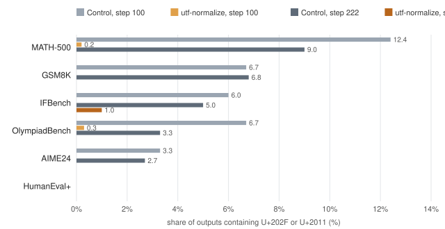

We tested whether removing flawed documents from Marin's cold-start SFT mix removes the behaviors those documents teach. Removing documents with more than 32,000 reasoning tokens from three sources did not reduce runaway reasoning after 222 training steps. The same 222-step setup did remove a second habit: replacing two Unicode characters that the gpt-oss teacher overuses cut their share of model outputs from 3-12% to 0-1%, with no measurable accuracy change. The typography arm shows that a data change can remove a copied habit within 222 steps, so the runaway result reflects the length filter itself. A scan of every stored eval output found few other data flaws that show up in model outputs, and none whose removal would raise pass rates by more than about 2 points.

[Marin data audit](https://github.com/marin-community/marin/issues/11188) · [Logbook issue](https://github.com/marin-community/marin-logbooks/issues/60) · [Original report](https://github.com/marin-community/marin-logbooks/blob/1dab7f2308f95df1dcef23f48152eee45537ce76/logbooks/60-sft-mix-filtering/report.md)

## Background

The 10.05 SFT model runs past 100,000 characters on 27-32% of AIME24 outputs and 45-53% of OlympiadBench outputs at temperature 0.7, and most of those outputs are wrong or never box an answer. An audit of the SFT mix in [marin#11188](https://github.com/marin-community/marin/issues/11188) listed data flaws that could teach this and other habits: very long reasoning traces, reasoning that ends by citing time pressure or guessing ("give-up endings"), gpt-oss typography, binary and pickle dumps in long-context replay data, multilingual damage, and agent traces that claim success without checking.

All arms use the historical 262,144-token-context cold-start recipe for the Grug 67B-A2B mixture-of-experts model, run for 222 of the recipe's 4,750 steps on 16 nodes (128 H100s), about 8.5 hours per arm. Each arm starts from the same weights and seed and differs from the control only in its cache catalog, the file that maps each mixture component to a tokenized store. Published checkpoints of the full run show the runaway habit at full strength by step 222: 37% of AIME24 outputs pass 100,000 characters at step 222, and 32-43% at steps 471, 1,024 and 2,048.

Evaluation uses six benchmarks served with vLLM on one 8xH100 node: AIME24 and OlympiadBench at temperature 0.7 with 10 samples per problem and a 73,664-token cap, plus MATH-500, GSM8K (0-shot), HumanEval+ and IFBench. GSM8K, HumanEval+ and IFBench run with thinking turned off. A difference is called decisive when it exceeds 1.96 combined binomial standard errors.

## Approach

### Length and give-up arms

The [first experiment](https://github.com/marin-community/marin/blob/dml/sft-patch-11188-experiment/experiments/sft_new_mix/patch_experiment/NOTEBOOK.md) had three arms:

| Arm | Change to the mix |
|---|---|
| `control` | none |
| `cap32k` | documents whose longest reasoning span exceeds 32,000 tokens removed from `math_v3`, competitive coding (Python and C++) and OpenThoughts4 |
| `cap32k-giveup` | as `cap32k`, plus documents with give-up endings removed from `math_v3` and competitive coding |

The filter, [`reasoning_store_filter.py`](https://github.com/marin-community/marin/blob/dml/sft-patch-11188-experiment/experiments/sft_new_mix/reasoning_store_filter.py), drops rows from the existing tokenized stores and copies kept rows token for token. The cap is a large dose: it removes 84% of competitive-coding tokens, 95% of OpenThoughts4 tokens and 31% of `math_v3` tokens. Sources the filter did not touch, such as `science_v2/vendor`, `math_v2/high`, `math_proofs_v2` and multilingual math, still put about 8% of training positions in long-reasoning documents, about a third of the control's exposure.

The decision rule, written before launch, required the share of outputs of at least 100,000 characters on AIME24 and OlympiadBench at step 222 to fall to at most half the control's, with no decisive accuracy loss on any benchmark.

### Pathology scan

After the first experiment, we scanned every stored output of the 10.05 model for behavior traceable to a #11188 flaw: about 72,000 model outputs and agent steps across 22 benchmarks. We also scanned the #11188 arms at steps 100 and 222. Each detector is a regular expression or a structural check tied to one flaw. We read hits by hand and discarded detectors whose hits came from the prompt, for example OlympiadBench prompts that contain the reference answer as context.

### Typography arm

The gpt-oss teacher writes U+202F (narrow no-break space) where other text uses a space, and U+2011 (non-breaking hyphen) where other text uses `-`. In the 2026.09.18 tokenizer each character is usually a single token, and the word after U+202F is split oddly: `110 miles` tokenizes as `110`, U+202F, `m`, `iles`. We chose this habit for the next arm because it is the most common teacher fingerprint in outputs and its training sources are exactly known. It also works as a positive control: if normalizing the data does not remove the characters from outputs within 222 steps, a null result on any other habit would carry no information.

The `utf-normalize` arm replaces U+202F with a space and U+2011 with a hyphen in every turn of every SFT store and leaves the replay data untouched. Because the stores hold token IDs only, the normalizer, [`typography_store_normalize.py`](https://github.com/marin-community/marin-logbooks/blob/89cbb2322b2a6b654888fd7a9aa2e213dbc410c3/experiments/sft_new_mix/typography_store_normalize.py), works at the token level:

1. Find each occurrence on the row's bytes. U+2011 is sometimes split across two tokens, so searching for token IDs misses some occurrences.
2. Decode the words around the occurrence, replace the character, and re-encode those words. The replacement text gets the tokens a fresh tokenization would give.
3. Check every rewritten row: it must decode to the source text with only those characters replaced, keep its special tokens, and contain neither character.

The source stores are opened read-only. A 900-row read-back of a written store found no mismatches. The normalizer rewrote 123 of 216 SFT stores, 7.1 million of 21.2 million rows, replacing 32.5 million U+202F and 45.9 million U+2011 characters. Total SFT tokens fell from 234.42 billion to 234.36 billion. The most affected stores were `opencode_v1/agent_skills` (100% of rows), `finance_v1` (99.6%), `math_proofs_v2` (94%), `instruction_following_chat_v3/instruction_following` (87%), `math_v2` (71-76%) and `math_v3` (34%).

In the 222 training steps, about 1.03 million SFT documents were drawn, and about 346,000 of them (34%) contained at least one of the characters; 156,000 of those fell in the first 100 steps. About 27% of all 14.9 billion training positions sit in such documents, but the repair changes only 0.02% of tokens: about 3.8 million characters replaced and 2.8 million tokens removed over 222 steps. These are estimates from the step-0 mixture weights and each store's share of rewritten rows; the derivation is in the [notebook](https://github.com/marin-community/marin-logbooks/blob/1dab7f2308f95df1dcef23f48152eee45537ce76/logbooks/60-sft-mix-filtering/notebook.md).

## Results

### Length and give-up arms

Neither filter passed the decision rule.

| Step 222 | AIME24 accuracy | AIME24 outputs >= 100k chars | AIME24 no boxed answer | OlympiadBench accuracy | OlympiadBench outputs >= 100k chars | OlympiadBench no boxed answer |
|---|---|---|---|---|---|---|
| control | 71.3% | 33.3% | 24.3% | 22.3% | 48.3% | 24.7% |
| cap32k | 77.0% | 32.0% | 19.7% | 22.4% | 51.8% | 21.7% |
| cap32k-giveup | 71.3% | 40.0% | 24.3% | 25.0% | 51.7% | 29.0% |
| pass threshold | | <= 16.7% | | | <= 24.2% | |

A fresh control reproduced the published step-222 checkpoint within 3.7 points (AIME24) and 5.0 points (OlympiadBench) on the long-output share. The only decisive difference is cap32k's AIME24 accuracy, +5.7 points. Almost all of that gain comes from long outputs that end with a correct answer (7.0% to 11.7% of outputs); accuracy on short outputs stays at 96%. With one seed, it needs replication before we treat it as real.

The 100,000-character threshold sits below the cap. At about 4-5 characters per token, 100,000 characters is 22,000-25,000 tokens, so the cap could leave that metric unchanged even if it worked. Paired per-problem differences at longer thresholds also show no reliable reduction. For cap32k on AIME24, the share of outputs over 150,000 characters falls 4.0 points (95% bootstrap interval -9 to +1), and over 200,000 characters it falls 4.3 points (-9 to 0). cap32k-giveup outputs got longer, by about 10,000-12,000 characters per problem on both benchmarks.

The give-up arm had almost nothing to remove. The training filter's own math give-up rule fires on 0-1.7% of outputs in every arm, the control included, against 3.7% of `math_v3` training rows. The model does not reproduce that phrasing, so this arm could not test whether give-up endings matter.

Runaway follows problem difficulty. Across problems, the per-problem long-output share correlates 0.91-0.95 between arms. In the control, problems that are never solved run long on 100% of AIME24 samples and 58% of OlympiadBench samples. Problems that are always solved run long on 0-5%.

### Pathology scan

Four pathologies were measurable and linked to a data flaw:

| Pathology | 10.05 model | #11188 arms at steps 100-222 | Suspected training source |
|---|---|---|---|
| gpt-oss typography (U+202F, U+2011) | 43% of MMLU-Pro outputs | 3-12% of math, GSM8K and IFBench outputs | teacher style in `finance_v1`, `math_v2`, `math_proofs_v2`, `math_v3` |
| Token soup: mixed-script gibberish in agent steps | 18% of TBLite and 22.5% of Terminal-Bench 2 trials; 0.3% of steps under 4k context tokens, 4.6% above 40k | not measured (the long agent evals were not run at step 222) | hypothesis: binary and pickle dumps in long-context replay data |
| Success claimed right after a visible error | 9.7% of TBLite and 3.7% of Terminal-Bench 2 trials | 3-7% of DS-1000 trials | agent traces that end with unverified success claims |
| Answer in the wrong language, or stray foreign words | 0.1-2.5% of outputs | 0.3-2.3% of outputs | multilingual v1 data |

Other flaws were absent or could not be scored from stored evals. Instructions quoted that the prompt does not contain occurred close to zero times once prompt text was excluded. "Perfect!" openers, summary files written into the repository, template tags and echoed replay junk each occurred in at most about 1% of outputs. Responses to harness warnings could not be scored, because the Terminus harness ran with inline thinking text and does not store raw responses. Hidden-test awareness could not be scored, because nearly every SWE-bench trial failed in the harness before its first step.

None of these pathologies is a large accuracy lever. Within the same task, TBLite and Terminal-Bench 2 trials with token soup pass less often than trials without it. Removing token soup entirely would add an estimated 1.7 points on TBLite (95% interval 0.2 to 3.4) and 1.9 points on Terminal-Bench 2 (0.4 to 4.1). This is an upper bound, because a trial that avoids soup can still fail another way. Success claims after an error are worth less than a point: they mark trials that were already failing. Typography costs nothing measurable. Of 116 graded answers that contain the characters, no wrong answer becomes right when they are removed.

### Typography arm

Normalizing the training data removed the characters from outputs at both checkpoints.

| Share of outputs containing U+202F or U+2011 | Control, step 100 | utf-normalize, step 100 | Control, step 222 | utf-normalize, step 222 |
|---|---|---|---|---|
| MATH-500 | 12.4% | 0.2% | 9.0% | 0.0% |
| GSM8K | 6.7% | 0.0% | 6.8% | 0.0% |
| IFBench | 6.0% | 0.0% | 5.0% | 1.0% |
| OlympiadBench | 6.7% | 0.3% | 3.3% | 0.0% |
| AIME24 | 3.3% | 0.0% | 2.7% | 0.0% |
| HumanEval+ | 0.0% | 0.0% | 0.0% | 0.0% |

*Figure 1. Share of outputs containing U+202F or U+2011, by benchmark, for the control and the utf-normalize arm at steps 100 and 222. HumanEval+ runs with thinking off and contains neither character in any arm.*

No benchmark prompt contains either character. The remaining hits are two outputs at step 100 (`3n‑6` in a MATH-500 table, `⟂ B` in an OlympiadBench answer) and three IFBench outputs at step 222 (`finite‑order`, `Nigeria‑style`, and a run of U+202F after an emoji).

Accuracy did not change measurably. At step 222 no accuracy, long-output or no-boxed-answer difference is decisive:

| Step 222 | AIME24 | OlympiadBench | MATH-500 | GSM8K | HumanEval+ | IFBench strict prompt |
|---|---|---|---|---|---|---|
| control | 71.3% | 22.3% | 95.0% | 81.2% | 68.3% | 19.7% |
| utf-normalize | 71.3% | 24.7% | 94.4% | 82.6% | 66.5% | 22.0% |

At step 100, GSM8K was 3.1 points lower (86.3% to 83.2%), the only decisive difference at that checkpoint, and it did not persist to step 222. The control alone moves 5.1 points on GSM8K between steps 100 and 222. The AIME24 long-output share rose 7.7 points at step 100 (36.0% to 43.7%, not decisive) and matched the control at step 222 (33.3% and 32.7%). Training losses for the first ten steps stayed within 0.003 of the control's.

The repair has no measured benefit beyond the incidence drop. None of the 31,710 agent steps of the 10.05 model contains either character in a tool call, so the characters do not break commands or code in these evals. Possible benefits that our evals do not test are copy-paste and parsing failures in user-facing text, such as `1\u202f000` failing `float()`, and the irregular tokenization after U+202F. The normalizer also replaces correct uses of U+202F in French and SI number formatting. We treat it as an optional cleanup; its value in this program was as a positive control.

Run pages: [control](https://wandb.ai/kailua-ventures/sft-data-patch-11188/runs/sft-patch-11188-control), [cap32k](https://wandb.ai/kailua-ventures/sft-data-patch-11188/runs/sft-patch-11188-cap32k), [cap32k-giveup](https://wandb.ai/kailua-ventures/sft-data-patch-11188/runs/sft-patch-11188-cap32k-giveup), [utf-normalize](https://wandb.ai/kailua-ventures/sft-data-patch-11188/runs/sft-patch-11188-utf-normalize). Eval run groups: `sft11188-<arm>-s100` and `sft11188-<arm>-s222` under `s3://marin-us-east-02a/marin/evals/`.

## Limitations

Each arm has one seed, and AIME24 and OlympiadBench have 30 problems each, so effects of a few points cannot be separated from run-to-run noise. The decisive-difference test treats the 10 samples of one problem as independent, which makes it too permissive on those two benchmarks.

The first experiment's design limits what its null result shows:

- The primary metric sat below the cap. A token-based threshold above 32,000 tokens would have matched the treatment.
- The dose was partial. About 8% of training positions stayed in long-reasoning documents from sources the filter did not touch.
- The give-up arm targeted phrasing the model does not produce. Applying the filter's rule to the control's existing outputs before launch would have shown this.
- Three of the six benchmarks ran with thinking off, so they could not detect a change in reasoning behavior. No reasoning-mode coding benchmark checked the cap, which removed 84% of competitive-coding tokens.

The typography result covers English and mostly math benchmarks. French number formatting uses U+202F correctly, and we did not evaluate non-English typography after normalization.

The `utf-normalize` training job hung at step 48 with every rank blocked inside the train step and no error. It held 128 GPUs for 10.5 hours before anyone noticed, then resumed from a step-36 checkpoint. The cause is not known.

The normalized stores, catalog and model exports sit under a 30-day temporary prefix, `s3://marin-us-east-02a/tmp/ttl=30d/sft-data-patch-11188/`, and expire in mid-December 2026. The full record, including the analysis scripts, is the [marin-logbooks#60 notebook](https://github.com/marin-community/marin-logbooks/blob/89cbb2322b2a6b654888fd7a9aa2e213dbc410c3/logbooks/60-sft-mix-filtering/notebook.md).
