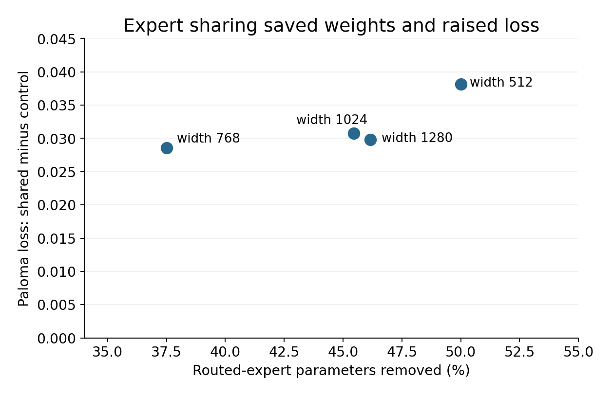

We trained Grug mixture-of-experts models with routed expert weights shared across several layers. At hidden width 1280, sharing removed 43.7% of the model's parameters and raised final Paloma loss from 2.89986 to 2.92965. The shared model processed 1.6% more tokens per second. Across all four tested widths, sharing reduced parameter count and increased held-out loss. [Final width-1280 comparison](https://github.com/marin-community/marin/issues/8032#issuecomment-5249559525)

[Marin experiment #8032](https://github.com/marin-community/marin/issues/8032)

## Approach

A routed expert bank contains the feed-forward networks that a layer's router selects for each token. The usual Grug model gives every layer its own bank. In the shared model, several layers read and update the same bank. Attention, routers, normalization, and the always-active feed-forward paths keep their own weights in each layer.

For example, six layers with bank IDs `0,1,1,1,1,2` use three distinct banks. The four middle layers share bank 1, but each still chooses its own experts for its own inputs. Sharing saves stored parameters while each layer continues to execute an expert computation. [Architecture and four-width results](https://github.com/marin-community/marin/issues/8032#completed-architecture-result)

Gradients from all layers using a bank accumulate into that bank. The plotted runs kept the original expert learning rate without dividing it by the number of uses. A smaller-width learning-rate ablation favored that setting, so the result is scoped to this optimizer recipe.

Within each width, the control and shared model used the same training budget. At width 1280, both trained for 14,315 updates and 15.01 billion tokens from seed 0. The control had 13 banks. The treatment kept the first two and last two layers independent and shared banks within two groups in the middle, leaving seven banks in total. [Matched run record](https://github.com/marin-community/marin/issues/8032#issuecomment-5249559525)

## Results

*Each point compares a shared model with its same-width control, using the original unscaled expert learning rate. Parameter savings count routed expert weights. Paloma macro loss gives each held-out text dataset equal weight. Each pair used one seed. [Source table](https://github.com/marin-community/marin/issues/8032#completed-architecture-result)*

At width 1280, whole-model parameter count fell from 8.64 billion to 4.86 billion. Routed-expert parameters fell 46.15%. All 256 experts remained active in each layer over the final measurement window, and routing overflow was zero. Those measurements show that the shared architecture could train at the tested sizes.

The throughput comparison was 126,778 versus 128,826 tokens per second. Applying the experiment's scaling law to account for the higher loss gave an estimated effective speed of 0.80 times the control. The estimate uses `loss(C) = 1.6 + A * C^(-0.0941)`, fitting A to the same-width control. It divides the estimated baseline time to match the treatment's loss by the treatment's observed training time. That assumes the baseline scaling curve and measured throughput continue to apply. Reaching a common quality target was not timed directly. We retained expert sharing as a compression result and stopped this architecture sweep. [Final measurements and decision](https://github.com/marin-community/marin/issues/8032#issuecomment-5249559525)
