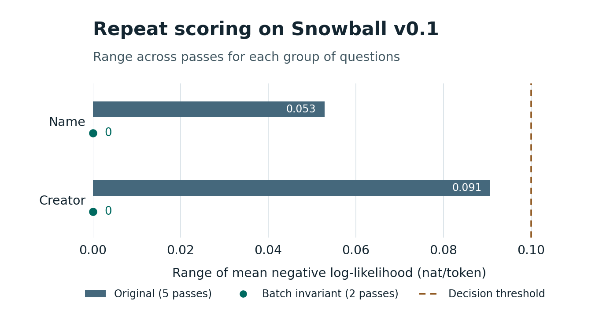

We used vLLM to decide whether a short fine-tune made Snowball better at naming itself and its creator. On our original serve, the same checkpoint's mean score on creator questions varied by 0.091 nat/token across five passes. An improvement of 0.10 nat/token could decide whether we kept training. In a retest on Marin's vLLM fork at `01911be3` with batch invariance enabled, all 206 answer-option scores matched exactly across two passes on the Snowball v0.1 baseline. [Repeat test](https://github.com/marin-community/marin/issues/10699#issuecomment-6866411632)

[Marin issue #10699](https://github.com/marin-community/marin/issues/10699) · [Identity experiment #10695](https://github.com/marin-community/marin/issues/10695) · [Identity SFT logbook](https://github.com/marin-community/marin-logbooks/issues/23)

## Background

For a question like “Who trained you?”, the scorer sends the prompt with each possible answer in turn and sums the log-probabilities of the answer tokens. To decide whether to continue a fine-tune, we compare the baseline and the candidate on how much probability they assign to the correct answer. For each question we divide the correct answer's negative log-probability by its token count, then average over questions about the model's name or its creator.

We sent one request at a time at temperature zero. The server could assign a repeat request to a different GPU worker. The assigned worker handles the request, but Snowball's experts span all eight workers. Token representations go to the workers that hold the chosen experts, and their outputs are combined. Adding the same floating-point values in a different order can change the result. On a separate four-worker configuration, scores matched on repeated requests pinned to the same worker but differed across workers. Summing expert outputs on one designated worker before redistributing them eliminated the measured cross-worker differences when the workers used the same compiled graph. The measured eight-worker fork uses this reduction under batch invariance. [Four-worker diagnostic](https://github.com/marin-community/marin/issues/10699#issuecomment-6553220242) · [Reduction code](https://github.com/marin-community/vllm/blob/01911be34fac8715347962a8d791ca34a879e01e/vllm/distributed/device_communicators/cuda_communicator.py#L525-L531)

## Approach and results

Batch invariance is vLLM's setting for making results independent of batch size and request order. We ran the baseline checkpoint again with `VLLM_BATCH_INVARIANT=1` and the default compile settings. As in the original run, we sent requests one at a time and let the server choose the worker. Across 24 primary questions, the scorer made 206 requests per pass. Every summed answer log-probability matched across the two passes. The mean for each question group also matched exactly. This retest used a different cluster and covered the baseline only. It leaves open whether the entire baseline-versus-candidate decision would repeat. [Batch invariance at the measured revision](https://github.com/marin-community/vllm/blob/01911be34fac8715347962a8d791ca34a879e01e/docs/features/batch_invariance.md) · [Original measurements](https://gist.github.com/karansag/2ac0c5798b18bfdbec9a81b7090361d2#file-m16-gate-baseline-json) · [Retest data](https://github.com/marin-community/marin/blob/da6495dba4c244d2fb30dd95f7fa748a45bb4010/experiments/post_training/issue_10699_results/gate-repeat-v0.1-batch-invariant.json)

*The range is the highest minus the lowest pass mean, over five original passes and two batch-invariant passes. Both measurements used the same 24 primary questions on Snowball v0.1. The decision threshold is shown for scale.*

We also tested fresh launches with batch invariance on a second checkpoint of the same architecture. All 17 prompts matched across eight workers, and across two fresh launches within each of two compile modes. Scores differed between modes by up to 0.0034 nat/token. For checkpoint comparisons on this stack, we can check repeatability with the same prompts and use the same compile mode for both checkpoints. The eight-worker test sent at most one request per worker at a time. [Launch measurements](https://github.com/marin-community/marin/tree/da6495dba4c244d2fb30dd95f7fa748a45bb4010/experiments/post_training/issue_10699_results) · [Closeout](https://github.com/marin-community/marin/issues/10699#issuecomment-6866411632)
