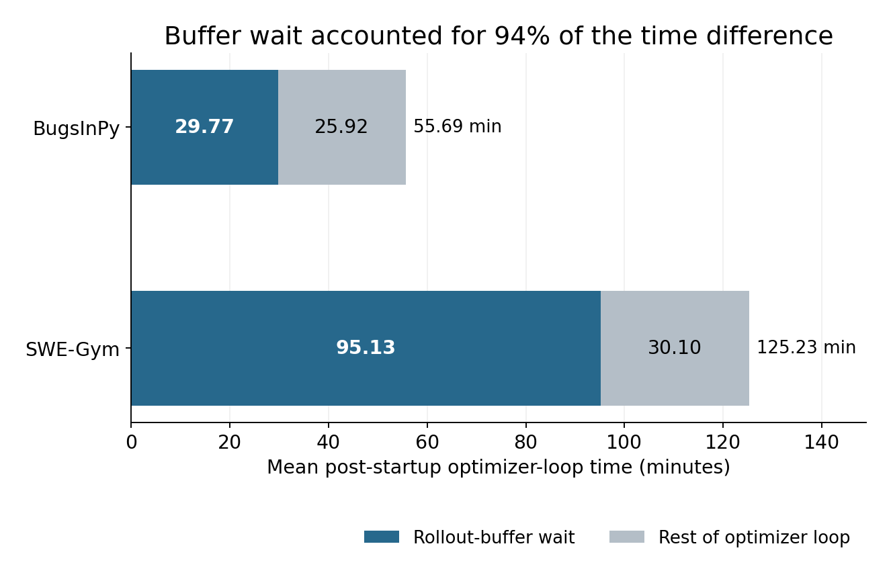

Two software-agent RL runs used Qwen3-Coder-30B-A3B with the same training and rollout-node geometry, yet their optimizer loops had very different step times. BugsInPy averaged 55.69 minutes after startup; SWE-Gym averaged 125.23. Waiting for a completed, scored rollout batch accepted for training accounted for 94% of the difference. The recorded environment and serving measurements point to repository execution and verification as major sources of that wait. [Timing analysis](https://gist.github.com/penfever/459e7d78bc46e1a14effe007cfcb076c)

[Marin experiment #8942](https://github.com/marin-community/marin/issues/8942)

## Approach

BugsInPy and SWE-Gym ask agents to repair software using repository tools and tests. Rollout workers run an agent in a task environment and send completed, scored trajectories to the trainer. Model generation overlaps with training. The trainer's buffer-wait timer starts when it needs a batch that has not yet been accepted for training. It includes delays from model calls, tool execution, verification, and replacing rejected groups.

Both software runs used two training nodes and three rollout nodes, six serving engines, each with tensor- and expert-parallel degrees of four, constant-denominator loss, rollout groups of 16, and zero allowed policy staleness: training waits for rollouts from the current policy. The timer covers the optimizer loop and excludes separately logged validation and checkpoint operations. The analysis drops the first completed step of each continuous attempt to avoid counting the initial buffer fill. [Timer scope and configurations](https://gist.github.com/penfever/459e7d78bc46e1a14effe007cfcb076c#file-step-time-breakdown-md)

## Results

*Post-startup means cover 13 BugsInPy steps and 14 SWE-Gym steps. The remaining bar segment contains conversion, forward scoring, advantage calculation, policy training, weight synchronization, and residual time. [Source CSV](https://gist.github.com/penfever/459e7d78bc46e1a14effe007cfcb076c#file-optimizer-timing-summary-csv)*

SWE-Gym carried 1.27 times as many post-prompt trajectory tokens per rollout. Its forward and policy-update times were each about 1.17 times BugsInPy's. Buffer wait was 3.20 times as long.

A sample of 256 complete BugsInPy and 220 complete SWE-Gym Harbor results put mean verifier time at 103.08 seconds for SWE-Gym and 7.79 seconds for BugsInPy. Agent execution was also longer. SWE-Gym tasks cloned full repositories and their verifiers installed dependencies and ran multiple test targets. BugsInPy used a prepackaged file and a smaller test invocation. Meanwhile, sampled vLLM waiting queues were zero and the SWE-Gym engines averaged one running request. Those observations support investigating the task execution path before adding serving capacity. [Harbor phase table and serving counters](https://gist.github.com/penfever/459e7d78bc46e1a14effe007cfcb076c#file-step-time-breakdown-md)

The phase means cannot reconstruct buffer wait exactly because tasks run concurrently and some completed work is rejected or replaced. The Harbor sample excludes 36 incomplete SWE-Gym records. The serving sample covers BugsInPy steps 8–22 and SWE-Gym steps 12–15, and BugsInPy was a continuation while SWE-Gym began at step 1. This decomposition identifies where the sampled runs spent time. It does not measure the gain from a particular environment optimization.
