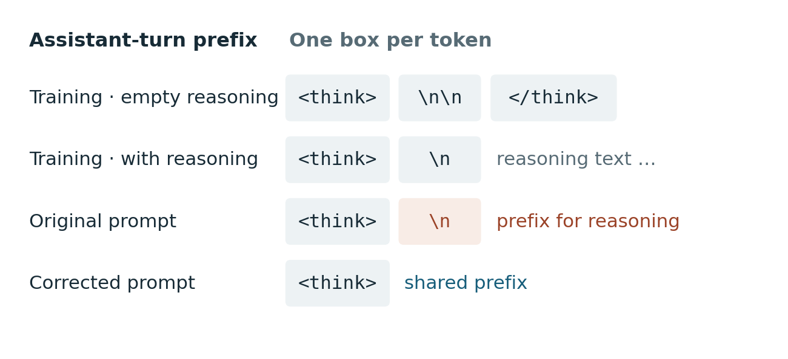

When we evaluated two Qwen3-8B fine-tunes on SWE-bench Verified, the Terminus-2 terminal agent reported parse errors even when the raw reply contained well-formed tool-call JSON. The JSON appeared before the closing reasoning tag. The serving parser treated it as reasoning and passed empty content to the terminal agent. We traced the mismatch to a newline token in the inference prompt.

[Marin experiment proposal](https://github.com/marin-community/marin/pull/10813) · [Logbook issue](https://github.com/marin-community/marin-logbooks/issues/39) · [Pinned diagnosis](https://github.com/marin-community/marin-logbooks/blob/e956e9f37c21915f59332bb2652768489d9e083f/logbooks/39-open-swe-outcome/notebook.md#2026-11-18-1845-utc---first-evaluation-attempt-generation-prompt-mismatch)

## Inspecting the reply

The fine-tunes were part of an experiment on whether to train only on successful coding-agent traces. We had rewritten the training traces into the Terminus-2 protocol so the models would learn the JSON reply format expected by the evaluator. The agent’s parser accepted all 42,725 replies in the converted held-out examples. [Training-format conversion](https://github.com/marin-community/marin-logbooks/blob/e956e9f37c21915f59332bb2652768489d9e083f/logbooks/39-open-swe-outcome/notebook.md#2026-11-17-2335-utc---terminus-2-format-arms)

The models still had parse errors in early evaluation trials. One had errors on 20 of 30 model replies and the other on nine of 24. In most failures, the raw reply contained well-formed JSON. After the serving parser split the reply into reasoning and visible content, Terminus-2 received an empty string. That located the failure before the agent’s JSON parser. [Diagnostic trials](https://github.com/marin-community/marin-logbooks/blob/e956e9f37c21915f59332bb2652768489d9e083f/logbooks/39-open-swe-outcome/notebook.md#2026-11-18-1845-utc---first-evaluation-attempt-generation-prompt-mismatch)

## Token boundaries

The training template opened each assistant turn with `<think>`. A turn without reasoning continued with a single token containing two newlines, then `</think>`. A turn with reasoning continued with a token containing one newline, then the reasoning text.

The inference prompt already supplied the single-newline token. Generating a second single-newline token would leave two tokens in the sequence. Training had represented that pair of newlines as one token. The old prefix matched the training sequence for a turn with reasoning. In the failure traces, the model emitted JSON inside that reasoning span.

*Each box represents one token in the Qwen3 rendering. The box labeled `\n\n` holds the single token for two newlines. [Tokenization diagnosis](https://github.com/marin-community/marin-logbooks/blob/e956e9f37c21915f59332bb2652768489d9e083f/logbooks/39-open-swe-outcome/notebook.md#2026-11-18-1845-utc---first-evaluation-attempt-generation-prompt-mismatch)*

We stopped the prompt at `<think>`, the prefix the two training sequences share, and evaluated the same checkpoints again. After infrastructure retries, the corrected runs produced task grades for 185 and 184 of 200 tasks. The logbook records those task grades and the earlier diagnostic parse counts. It leaves the change in parse-error frequency unmeasured. [Prompt fix](https://github.com/marin-community/marin-logbooks/commit/e06b464dd3) · [Final evaluation](https://github.com/marin-community/marin-logbooks/blob/e956e9f37c21915f59332bb2652768489d9e083f/logbooks/39-open-swe-outcome/notebook.md#2026-11-19-2230-utc---retry-of-ungraded-trials)
