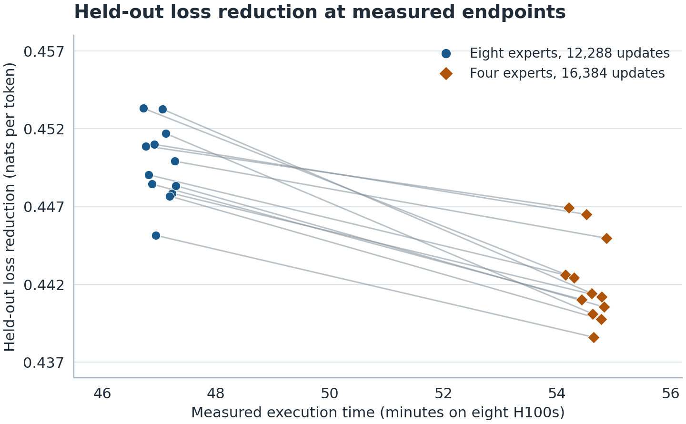

We tried to speed up pretraining by computing updates with four routed experts per token, then evaluating the resulting weights with all eight. On Belay, a roughly 1B-parameter mixture-of-experts model, ordinary eight-expert training reached lower held-out loss in 12,288 updates than the four-expert draft reached in 16,384. That happened in all twelve paired comparisons. The draft took 16.1% more measured execution time at the median. [Paired measurements](https://storage.googleapis.com/marin-public/benfeuer/tied-drafter-belay/2026.10.24/measurements/crossover16k-measured-comparison.json)

[Marin experiment #10654](https://github.com/marin-community/marin/issues/10654) · [Archived experiment code](https://github.com/marin-community/marin/pull/10653)

## Approach

Belay's router normally selects eight experts per token. For each token in the draft, we kept its top four experts and rescaled their contributions to preserve the original total routing weight. The draft used ordinary backpropagation. It updated the same network weights the eight-expert model uses, so we could switch back to eight active experts to evaluate a draft checkpoint. The idea was to spend less on backward passes and use occasional full-model forward passes to check progress. [Experiment protocol](https://storage.googleapis.com/marin-public/benfeuer/tied-drafter-belay/2026.10.24/crossover-k4-16384-v1.json)

For each pair, we started both branches from the same checkpoint, fed them the same training batches up to their shared update count, and timed both on the same eight H100s. We used three independently trained starting checkpoints and four data windows per checkpoint. We checked the completed draft on a reserved batch with eight experts active. It passed if its loss dropped by more than twice the spread from three repeat evaluations of the starting checkpoint, with a small numerical floor. Four other batches measured held-out loss for the comparison with ordinary training. [Experiment protocol](https://storage.googleapis.com/marin-public/benfeuer/tied-drafter-belay/2026.10.24/crossover-k4-16384-v1.json)

## Results

All twelve final drafts passed the acceptance check. At 16,384 updates, the draft also took about 13% less measured time than ordinary training for the same number of steps. After 12,288 updates, ordinary training's held-out loss was already 0.0075 nats per token lower on average than the draft's final loss. [Acceptance and matched-update results](https://storage.googleapis.com/marin-public/benfeuer/tied-drafter-belay/2026.10.24/measurements/crossover16k-efficiency.json)

*Loss reduction is measured from the starting checkpoint, so higher is better. Each line connects two endpoints from the same starting checkpoint and data window. Time covers update execution on eight H100s and, for the draft, the initial weight copy and one pair of loss checks. Restore, compilation, data loading and research diagnostics were tracked separately. [Figure data](https://storage.googleapis.com/marin-public/benfeuer/tied-drafter-belay/2026.10.24/measurements/crossover16k-measured-comparison.json)*

A draft could pass by improving on its starting checkpoint. The endpoint comparison priced that improvement against what ordinary training achieved in less time. These were continuation runs that spent most of their updates at the original learning-rate floor. We timed one proposal with verification at the end and stopped testing this recipe after the 16,384-update runs. [Decision record](https://github.com/marin-community/marin/issues/10654#conclusion)
