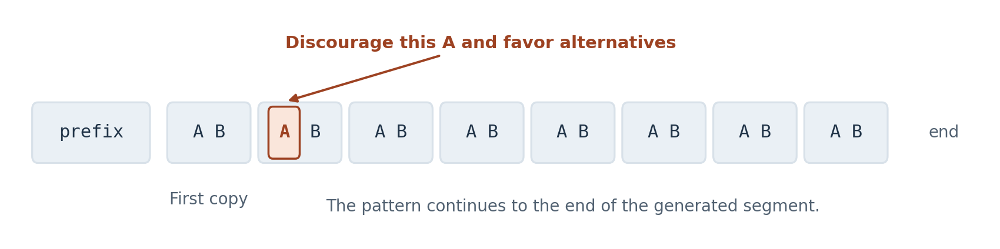
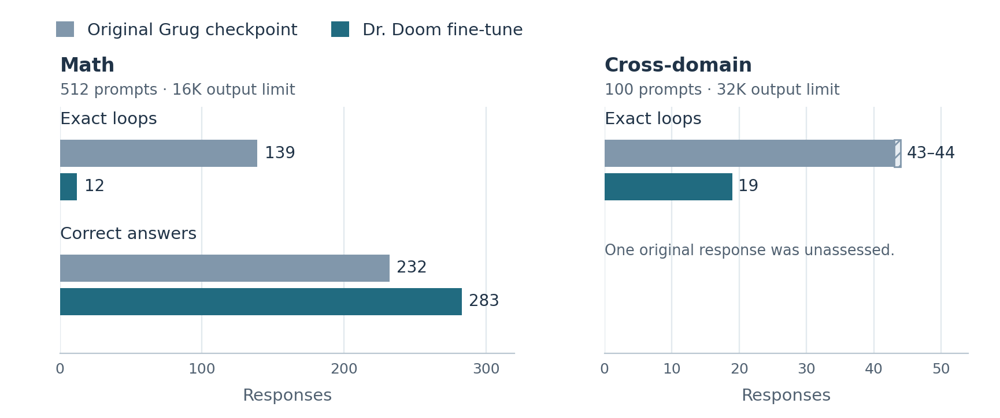

Can we train Grug to produce fewer exact repetition loops while keeping its math accuracy? On the same 512 math prompts with a 16K output limit, the September 21 Grug-67B-A2B supervised fine-tune produced 139 exact loops and 232 correct answers. The checkpoint we released as Dr. Doom produced 12 loops and 283 correct answers. We trained it to change the next token at the point where a repeat begins. [Released model and evaluation summary](https://huggingface.co/open-athena/Grug-67B-A2B-Datakit-SFT-262K-2026.09.21-dr-doom)

[Marin experiment #9691](https://github.com/marin-community/marin/issues/9691)

## Approach

A loop can spend the remaining output budget repeating a phrase. During training, the model generated answers by choosing the highest-scored token at each step. After generation, we looked for at least eight consecutive copies of a token pattern at the end of the final stretch of assistant output used for training. That let us identify the earlier token where the repetition began. In the toy response below, the first copy of `A B` establishes the pattern. The next `A` is the token that starts the first repeat. [Suffix detector](https://github.com/marin-community/MarinSkyRL/blob/a090abe57113a375e8dbee05ea0cf7e17daa2316/skyrl-train/skyrl_train/trajectory_runners/trajectory_reward_shaping.py#L251-L294)

*Illustration of the training target for a two-token pattern.*

At that position, we took alternatives from the model's 32 highest-scored tokens, screening out candidates that wrote the same text as the repeated token and candidates with low scores. We trained the surviving alternatives to score above the repeated token by a margin. A penalty pulled the scores toward those of a frozen reference model to limit how much they moved. This is an online adaptation of final-token preference optimization (FTPO). A separate task verifier counted correct math answers. [FTPO implementation](https://github.com/marin-community/MarinSkyRL/blob/a090abe57113a375e8dbee05ea0cf7e17daa2316/skyrl-train/skyrl_train/ftpo.py)

## Results

On a separate set of 100 matched prompts spanning several domains at a 32K output limit, the original checkpoint had 43 confirmed loops and one unassessed response. The released checkpoint had 19 loops. We counted responses flagged by the same eight-copy rule, searching the full output window with maximum pattern lengths of 2,048 tokens at 16K and 4,096 tokens at 32K. Irregular repetition and repeated ideas can escape an exact-token check. [Evaluation protocol and results](https://huggingface.co/open-athena/Grug-67B-A2B-Datakit-SFT-262K-2026.09.21-dr-doom)

*Counts from one evaluation per checkpoint on each matched set. The range for the original cross-domain checkpoint accounts for one unassessed response. [Math evaluation receipt](https://huggingface.co/open-athena/Grug-67B-A2B-Datakit-SFT-262K-2026.09.21-dr-doom/blob/main/evidence/dapo-mixed-long-smoke-v2-step2-loops.json) · [Original cross-domain receipt](https://huggingface.co/open-athena/Grug-67B-A2B-Datakit-SFT-262K-2026.09.21-dr-doom/blob/main/evidence/cross-domain-original-32k-full-window-loops-v2.json) · [Fine-tuned cross-domain receipt](https://huggingface.co/open-athena/Grug-67B-A2B-Datakit-SFT-262K-2026.09.21-dr-doom/blob/main/evidence/cross-domain-mixed-long-smoke-v2-step2-loops.json)*

The evaluations used the same prompts with different runtimes and weight-loading setups, so the comparisons cannot separate the effect of the training objective from the other changes. Across the math set and the cross-domain set, the selected checkpoint missed its loop target in 10 of 17 measured domains. Small domain counts make individual rates noisy. On the larger math set, 12 loops out of 512 still exceeded the campaign's 2% threshold. [Per-domain results](https://huggingface.co/open-athena/Grug-67B-A2B-Datakit-SFT-262K-2026.09.21-dr-doom/blob/main/selected-domain-results.md)
